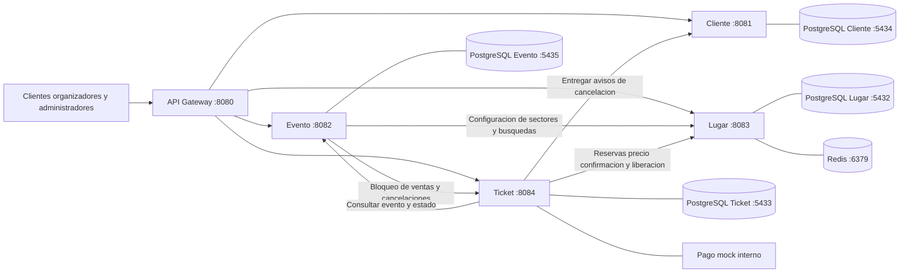
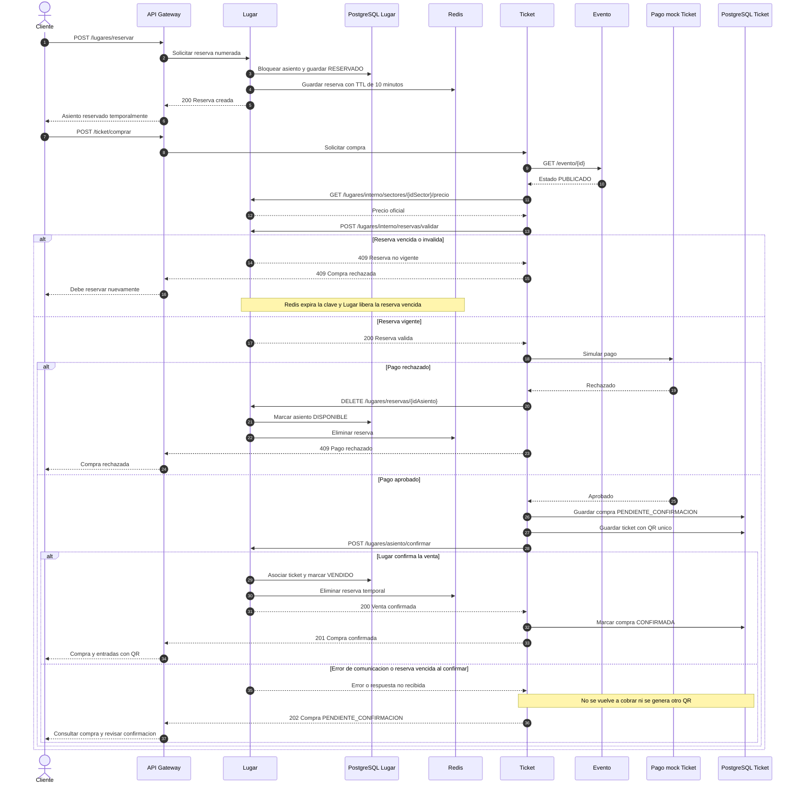
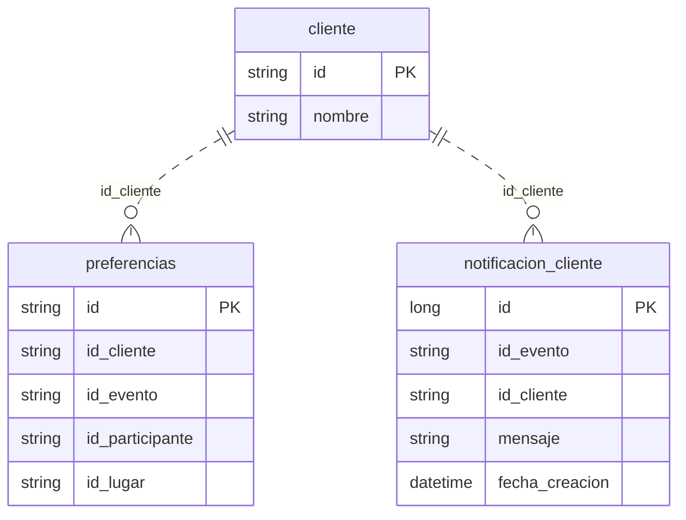
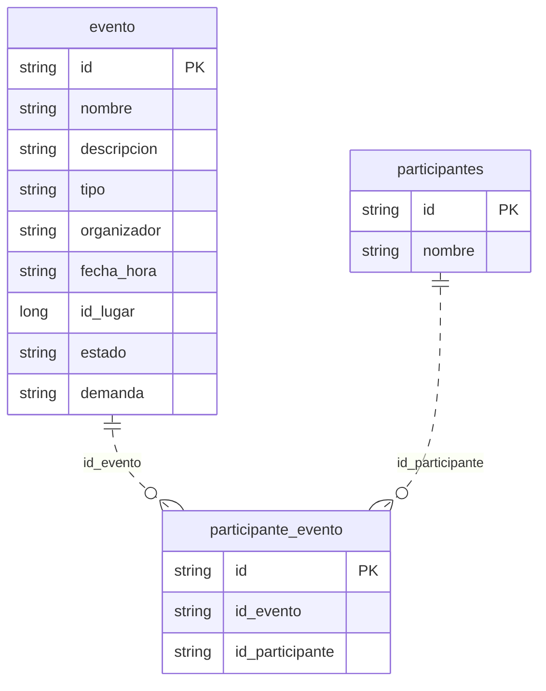
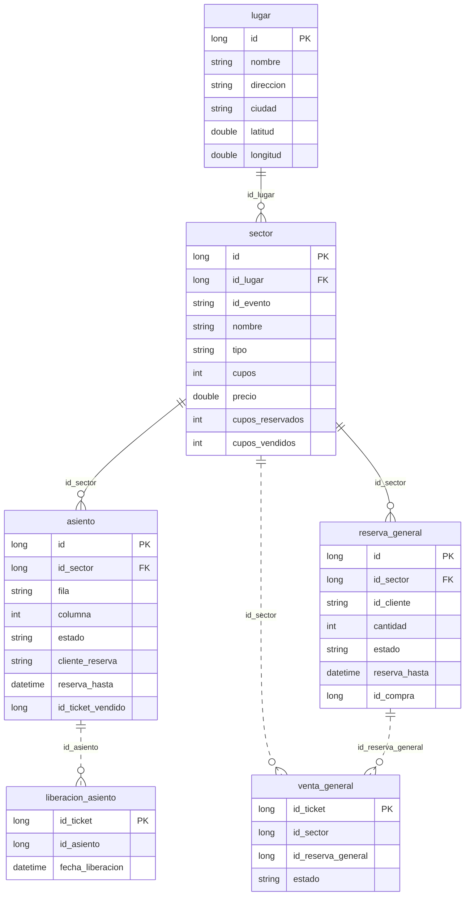
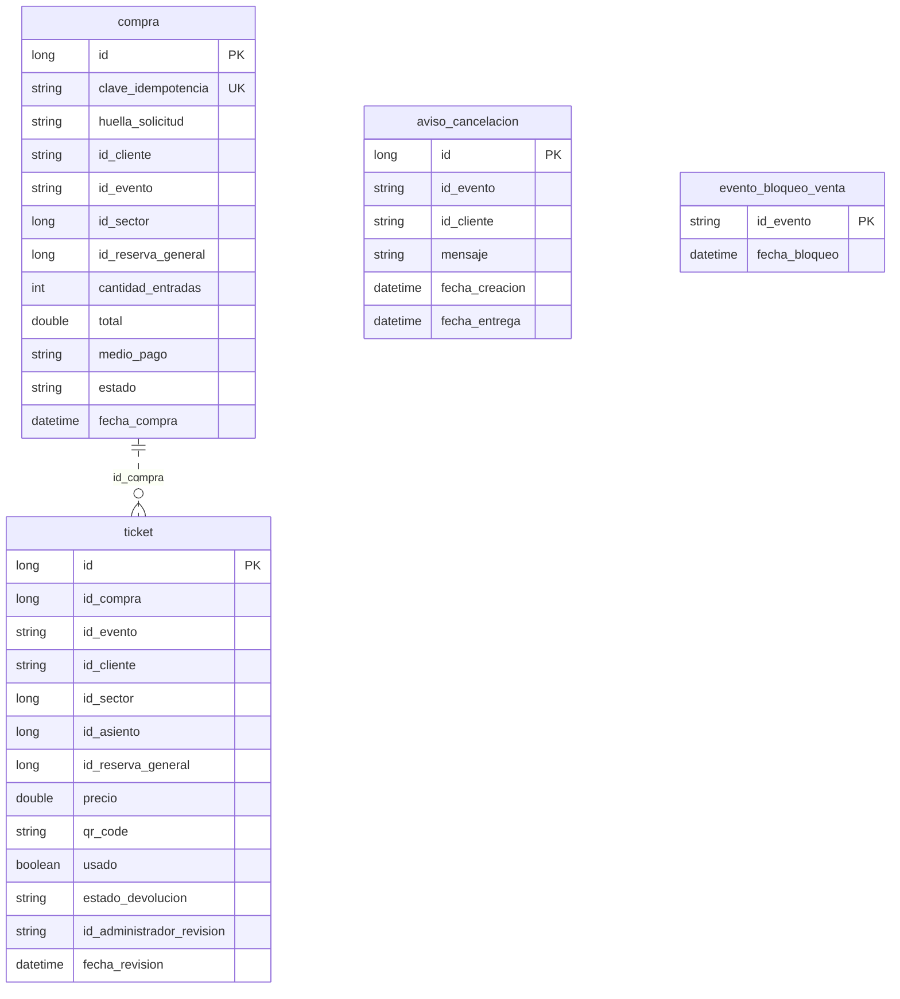

# ENTREGA 1 TICKETYA

## Tabla de contenidos

1. [Instalacion y ejecucion](#instalacion-y-ejecucion)
2. [Features y User Stories](#features-y-user-stories)
3. [Arquitectura de microservicios](#arquitectura-de-microservicios)
4. [Modelo de datos](#modelo-de-datos)
5. [Diseño de API REST](#diseño-de-api-rest)
6. [OpenAPI y Swagger](#openapi-y-swagger)
7. [Testing](#testing)
8. [Metodologia de desarrollo](#metodologia-de-desarrollo)
9. [Postman y datos de prueba](#postman-y-datos-de-prueba)

# Instalacion y ejecucion

## Requisitos

- Java 17 o superior
- IntelliJ IDEA con Maven
- Docker Desktop
- PowerShell

## Levantar las bases de datos

Desde la carpeta `TicketYa`

```powershell
docker compose up -d postgres-lugar postgres-ticket postgres-cliente postgres-evento redis
```

Se utilizan cuatro bases PostgreSQL y Redis para las reservas temporales

Si es la primera vez que se ejecuta hay que crear las tablas de Cliente y Evento antes de iniciar los microservicios porque utilizan `ddl-auto=validate`

Estos pasos se realizan solamente la primera vez, cuando las bases estan vacias
Ejecutar desde la carpeta TicketYa
```powershell
$cliente = Get-Content -Raw -Encoding UTF8 .\migracion\sql\postgres-cliente.sql
($cliente + "`nCOMMIT;") | docker exec -i ticketya-postgres-cliente psql -X -v ON_ERROR_STOP=1 -U postgres -d ticketya_clientes

$evento = Get-Content -Raw -Encoding UTF8 .\migracion\sql\postgres-evento.sql
($evento + "`nCOMMIT;") | docker exec -i ticketya-postgres-evento psql -X -v ON_ERROR_STOP=1 -U postgres -d ticketya_eventos
```
Tabla de notificaciones
```powershell
Get-Content -Raw -Encoding UTF8 .\db\migrations\004_notificaciones_cliente.sql |
docker exec -i ticketya-postgres-cliente psql -X -v ON_ERROR_STOP=1 -U postgres -d ticketya_clientes
```
### Crear las tablas de Lugar y Ticket

Iniciar los microservicios Lugar y Ticket desde IntelliJ para que Hibernate cree las tablas automaticamente
Una vez creadas detener ambos servicios y aplicar las restricciones SQL

Aplicar restricciones de la base
```powershell
Get-Content -Raw -Encoding UTF8 .\db\migrations\003_asiento_fisico_unico.sql |
docker exec -i ticketya-postgres-lugar psql -X -v ON_ERROR_STOP=1 -U postgres -d ticketya_lugares
```

```powershell
$archivos = @(
    "001_ticket_asiento_activo.sql",
    "002_idempotencia_p5.sql",
    "003_bloqueo_cancelacion_eventos.sql",
    "004_aviso_entrega_ticket.sql"
)

foreach ($archivo in $archivos) {
    Get-Content -Raw -Encoding UTF8 ".\db\migrations\$archivo" |
    docker exec -i ticketya-postgres-ticket psql -X -v ON_ERROR_STOP=1 -U postgres -d ticketya_tickets

    if ($LASTEXITCODE -ne 0) {
        throw "Error aplicando $archivo"
    }
}
```
Despues volver a iniciar los microservicios

> [NOTE]
> 
> Aclaracion sobre la instalacion
> 
> Durante el desarrollo tuvimos una confusion con los requisitos de persistencia entre la Entrega 1 y la Entrega 2
> 
> Inicialmente trabajamos con MongoDB y posteriormente migramos los microservicios a PostgreSQL para cumplir con el ennunciado de la entrega 1
> 
> Debido a que le error fue detectado en etapas tardias del proyecto no pudimos verificar completamente la instalacion del proyecto desde cero en otro equipo
> 
> aunque los microservicios y las pruebas funcionan correctamente en nuestro entorno de desarrollo
> 
> Dejamos documentados los pasos necesarios para ejecutar el sistema
> 
> Pedimos disculpas por cualquier inconveniente que pueda surgir durante la instalacion y agradecemos la comprension

## Ejecutar el proyecto

Abrir los proyectos Maven en IntelliJ y ejecutar las aplicaciones Spring Boot

| Aplicacion | Puerto |
|---|---|
| Cliente | 8081 |
| Evento | 8082 |
| Lugar | 8083 |
| Ticket | 8084 |
| API Gateway | 8080 |

El Gateway es el punto de entrada para las peticiones externas

Para comprobar que funciona

```powershell
Invoke-WebRequest "http://localhost:8080/evento" -UseBasicParsing
```

## Pruebas

Los tests se ejecutan desde Maven en IntelliJ con `test`


# Features y User Stories

Puntos 1, 2, 3, 4, 5, 7 y 9 del enunciado

Las historias siguen el formato **Como [rol] quiero [acción] para [beneficio]**

Los criterios de aceptación describen qué tiene que pasar para considerar terminada cada historia

## Features

| ID | Feature | Descripción | Punto del enunciado |
|---|---|---|---|
| F01 | Gestionar eventos | Crear y modificar eventos con sus datos y participantes | 1 |
| F02 | Configurar lugares y sectores | Registrar lugares y definir sectores y precios por evento | 2 |
| F03 | Publicar y administrar eventos | Publicar borradores y controlar el estado de los eventos | 3 |
| F04 | Reservar y comprar entradas | Reservar lugares temporalmente y confirmar compras con pago y QR | 4 |
| F05 | Evitar la doble venta | Impedir ventas duplicadas ante concurrencia o reintentos | 5 |
| F06 | Gestionar devoluciones y cancelaciones | Solicitar devoluciones y procesar reintegros individuales o masivos | 7 |
| F07 | Buscar eventos | Buscar por varios criterios y ordenar los resultados | 9 |

---

## F01 — Gestionar eventos

### US01 — Crear evento

**Como** organizador **quiero** crear un evento en borrador **para** configurar sus datos antes de publicarlo

**Criterios de aceptación**

- Se debe permitir ingresar nombre descripción tipo organizador fecha y hora y lugar
- Se debe generar un ID para identificar al evento
- Se debe guardar el evento en estado BORRADOR
- Se debe informar si faltan datos obligatorios o tienen un formato inválido

### US02 — Modificar borrador

**Como** organizador **quiero** editar los datos de mi evento **para** corregirlos antes de publicarlo

**Criterios de aceptación**

- Se debe permitir modificar los datos de un evento en estado BORRADOR
- Se debe verificar que el organizador corresponda al evento
- No se debe permitir editar un evento publicado mediante esta operación
- Se deben conservar los cambios realizados

### US03 — Asignar participantes

**Como** organizador **quiero** agregar participantes a mi evento **para** indicar qué artistas equipos o disertantes van a participar

**Criterios de aceptación**

- Se debe permitir registrar participantes
- Se debe permitir asociar participantes a un evento en borrador
- Se debe permitir consultar los participantes de un evento
- Se debe permitir quitar participantes antes de la publicación

## F02 — Configurar lugares y sectores

### US04 — Registrar lugar

**Como** organizador **quiero** registrar un lugar **para** indicar dónde se realizará un evento

**Criterios de aceptación**

- Se debe permitir registrar nombre dirección ciudad latitud y longitud del lugar
- Se debe generar un ID para identificar el lugar
- Se debe poder consultar los lugares registrados

### US05 — Configurar sector numerado

**Como** organizador **quiero** configurar sectores con filas y asientos **para** vender ubicaciones específicas

**Criterios de aceptación**

- Se debe permitir asociar un sector numerado a un lugar y a un evento
- Se debe permitir registrar la fila y el número o columna de cada asiento
- No se debe permitir duplicar la misma ubicación dentro de un sector
- Se debe poder consultar la disponibilidad de los asientos

### US06 — Configurar sector general

**Como** organizador **quiero** crear sectores sin asientos numerados **para** vender entradas con una capacidad máxima

**Criterios de aceptación**

- Se debe permitir crear un sector general asociado a un lugar y un evento
- Se debe definir una capacidad máxima para el sector
- El sistema no debe permitir superar esa capacidad con reservas o ventas
- Se debe poder consultar la disponibilidad del sector

### US07 — Definir precios

**Como** organizador **quiero** asignar un precio a cada sector **para** establecer cuánto cuesta la entrada de ese evento

**Criterios de aceptación**

- Se debe permitir definir un precio para cada sector asociado al evento
- El precio debe ser mayor que cero
- El precio de la compra se debe obtener del sector configurado y no del valor enviado por el cliente

## F03 — Publicar y administrar eventos

### US08 — Publicar evento

**Como** organizador **quiero** publicar un evento en borrador **para** que los clientes puedan encontrarlo y comprar entradas

**Criterios de aceptación**

- Se debe verificar que el organizador corresponda al evento
- Se debe validar que el evento tenga los datos necesarios participantes y sectores con precios
- Si cumple las condiciones debe pasar de BORRADOR a PUBLICADO
- Si faltan datos no se debe publicar y se debe informar el motivo

### US09 — Suspender o reactivar evento

**Como** administrador **quiero** suspender o reactivar un evento **para** controlar temporalmente su venta

**Criterios de aceptación**

- Se debe permitir suspender un evento que esté PUBLICADO o AGOTADO
- Se debe permitir reactivar un evento SUSPENDIDO
- No se deben permitir compras nuevas mientras el evento esté suspendido
- Se debe registrar el estado actualizado del evento

### US10 — Cancelar evento

**Como** administrador **quiero** cancelar un evento **para** impedir nuevas ventas cuando no puede realizarse

**Criterios de aceptación**

- Se debe permitir cambiar el estado del evento a CANCELADO
- No se deben permitir nuevas compras para el evento cancelado
- La cancelación debe iniciar el proceso de devolución de las entradas vendidas
- La gestión de reintegros y avisos se detalla en US21

### US11 — Marcar agotado o finalizado

**Como** administrador **quiero** actualizar un evento a AGOTADO o FINALIZADO **para** reflejar su situación

**Criterios de aceptación**

- Se debe permitir marcar como AGOTADO un evento publicado
- Se debe permitir finalizar un evento publicado o agotado cuando su fecha ya haya pasado
- Se debe guardar el estado actualizado
- Los eventos que no estén publicados no deben admitir compras nuevas

## F04 — Reservar y comprar entradas

### US12 — Reservar asientos numerados

**Como** cliente **quiero** reservar asientos específicos **para** mantenerlos disponibles mientras realizo el pago

**Criterios de aceptación**

- Se debe verificar que cada asiento esté disponible
- Se debe reservar temporalmente por 10 minutos
- Otro cliente no debe poder reservar el mismo asiento durante ese plazo
- Si la reserva vence el asiento debe volver a estar disponible

### US13 — Reservar cupos generales

**Como** cliente **quiero** reservar entradas de un sector general **para** asegurar mis lugares mientras pago

**Criterios de aceptación**

- Se debe verificar que queden cupos disponibles
- La reserva debe tener un vencimiento temporal
- Las reservas vigentes deben descontarse de la disponibilidad
- Cuando la reserva se libera o vence los cupos deben recuperarse

### US14 — Comprar entradas y recibir QR

**Como** cliente **quiero** pagar mis entradas **para** obtener los tickets que necesito para asistir al evento

**Criterios de aceptación**

- Se debe permitir comprar entradas numeradas o generales de un evento PUBLICADO
- El pago debe realizarse mediante la pasarela simulada
- Si el pago se aprueba se debe confirmar la compra y registrar el medio de pago
- Se debe emitir un ticket con un código QR único por entrada
- Se debe guardar el detalle de la compra y permitir consultarlo

### US15 — Manejar pago rechazado o reserva vencida

**Como** cliente **quiero** que el sistema informe si mi compra no pudo completarse **para** saber si debo intentar nuevamente

**Criterios de aceptación**

- Si el pago es rechazado no se deben emitir entradas
- Los asientos o cupos reservados deben liberarse ante un rechazo
- Si la reserva venció no se debe confirmar la venta
- Se debe informar que la operación no pudo completarse

### US16 — Respetar el límite de entradas

**Como** administrador **quiero** limitar cuántas entradas compra un cliente por evento **para** evitar compras excesivas

**Criterios de aceptación**

- Se debe contabilizar la cantidad de entradas activas del cliente para el mismo evento
- Se debe rechazar una compra que supere el límite configurado
- Se debe aplicar la regla tanto a entradas numeradas como generales
- No se debe modificar el stock cuando la compra es rechazada por superar el límite

## F05 — Evitar la doble venta

### US17 — Comprar sin doble venta

**Como** cliente **quiero** que mis entradas se asignen de manera segura **para** no recibir una ubicación vendida a otra persona

**Criterios de aceptación**

- Si varios clientes intentan reservar el mismo asiento solo uno debe conseguirlo
- Si varios clientes intentan comprar el último cupo general no se debe superar la capacidad
- Un asiento vendido no debe poder venderse otra vez
- Se debe mantener la protección con compras simultáneas mediante la base de datos

### US18 — Reintentar una compra

**Como** cliente **quiero** reintentar una compra interrumpida **para** conocer su resultado sin pagar dos veces

**Criterios de aceptación**

- Se debe poder identificar una compra repetida mediante una clave de idempotencia
- Repetir la misma operación no debe generar tickets duplicados
- Se debe permitir recuperar el estado de una compra que quedó pendiente de confirmación
- Si la compra ya fue confirmada se debe devolver su resultado sin realizar un nuevo cobro

## F06 — Gestionar devoluciones y cancelaciones

### US19 — Solicitar devolución

**Como** cliente **quiero** solicitar la devolución de una entrada **para** recuperar el dinero si no puedo asistir

**Criterios de aceptación**

- Se debe verificar que la entrada pertenezca al cliente indicado
- Se debe permitir solicitar la devolución hasta 72 horas antes del evento
- Si faltan menos de 72 horas se debe rechazar la solicitud
- La solicitud aceptada debe quedar pendiente de revisión

### US20 — Revisar devolución

**Como** administrador **quiero** aprobar o rechazar una solicitud de devolución **para** resolver el pedido del cliente

**Criterios de aceptación**

- Se debe permitir revisar una solicitud pendiente
- El administrador debe poder aprobarla o rechazarla
- Si se aprueba se debe solicitar el reintegro a la pasarela simulada
- Una vez reintegrado el importe se debe liberar el asiento o cupo general
- Si se rechaza la entrada debe conservar su venta

### US21 — Reintegrar entradas por cancelación

**Como** administrador **quiero** que se reintegren las entradas de un evento cancelado **para** devolver el dinero a sus compradores

**Criterios de aceptación**

- Se debe impedir que continúen las compras después de cancelar el evento
- Se deben procesar los reintegros de las entradas vendidas
- Se deben liberar los asientos y cupos cuando corresponda
- Se debe registrar un aviso de cancelación por comprador
- Se debe entregar el aviso a la bandeja interna de cada cliente
- Si un reintegro o aviso falla se debe poder reintentar sin generar duplicados

## F07 — Buscar eventos

### US22 — Buscar con varios criterios

**Como** cliente **quiero** buscar eventos usando filtros **para** encontrar los que me interesan

**Criterios de aceptación**

- Se debe permitir filtrar por tipo de evento organizador y participante
- Se debe permitir filtrar por ciudad y rango de fechas
- Se debe permitir combinar varios filtros en una misma búsqueda
- Se deben mostrar solo los eventos disponibles para consulta pública
- Si no existen coincidencias se debe devolver una lista vacía

### US23 — Ordenar resultados

**Como** cliente **quiero** ordenar los eventos encontrados **para** comparar las opciones de compra

**Criterios de aceptación**

- Se debe permitir ordenar los resultados por fecha
- Se debe permitir ordenar por precio según los sectores del evento
- Se debe permitir ordenar por relevancia según la búsqueda
- El ordenamiento debe funcionar también cuando se usan varios filtros

# Arquitectura de microservicios

Desarrollo con microservicios Spring Boot independientes

Cada microservicio tiene su propio proyecto Maven su API REST y su base PostgreSQL

El acceso externo se realiza mediante el API Gateway

## 1. Microservicios y responsabilidades

| Microservicio | Puerto | Responsabilidad |
|---|---|---|
| API Gateway | 8080 | Recibir las peticiones externas y dirigirlas al microservicio correspondiente |
| Cliente | 8081 | Registrar clientes guardar preferencias y mostrar avisos internos de cancelación |
| Evento | 8082 | Crear y modificar eventos administrar participantes publicar suspender cancelar y buscar eventos |
| Lugar | 8083 | Registrar lugares y sectores manejar precios asientos reservas numeradas y cupos generales |
| Ticket | 8084 | Procesar compras pagos simulados emisión de entradas QR devoluciones reintegros y avisos de cancelación |

**Persistencia**

| Microservicio | Base de datos | Puerto PostgreSQL |
|---|---|---|
| Cliente | `ticketya_clientes` | 5434 |
| Evento | `ticketya_eventos` | 5435 |
| Lugar | `ticketya_lugares` | 5432 |
| Ticket | `ticketya_tickets` | 5433 |

Lugar también utiliza **Redis en el puerto 6379** para las reservas temporales de asientos numerados con TTL de 10 minutos

Los pagos es un mock dentro de Ticket que no consume un proveedor de pagos real

## 2. API pública

Las siguientes rutas muestran las operaciones principales de cada microservicio

### Cliente

| Método | Ruta | Función |
|---|---|---|
| POST | `/clientes` | Crear cliente |
| GET | `/clientes/{id}` | Consultar cliente |
| POST | `/clientes/preferencias` | Guardar preferencias |
| GET | `/clientes/{id}/notificaciones` | Consultar avisos del cliente |

### Evento

| Método | Ruta | Función |
|---|---|---|
| POST | `/evento` | Crear evento en borrador |
| PUT | `/evento/{id}?idOrganizador=...` | Modificar borrador |
| PUT | `/evento/{id}/estado?idOrganizador=...` | Publicar evento |
| PATCH | `/evento/{id}/suspender?idAdministrador=...` | Suspender evento |
| PATCH | `/evento/{id}/reactivar?idAdministrador=...` | Reactivar evento |
| PATCH | `/evento/{id}/cancelar?idAdministrador=...` | Cancelar evento |
| POST | `/evento/{id}/reintentar-cancelacion?idAdministrador=...` | Reintentar reintegros y avisos pendientes |
| PATCH | `/evento/{id}/agotar?idAdministrador=...` | Marcar agotado |
| PATCH | `/evento/{id}/finalizar?idAdministrador=...` | Finalizar evento |
| GET | `/evento` | Listar eventos publicados |
| GET | `/evento/{id}` | Consultar evento por ID |
| GET | `/evento/buscar` | Buscar por tipo organizador participante ciudad fechas y orden |
| POST | `/evento/participantes` | Registrar participante |
| GET | `/evento/participantes` | Listar participantes |
| GET | `/evento/{idEvento}/participantes` | Consultar participantes del evento |
| POST | `/evento/{idEvento}/participantes/{idParticipante}?idOrganizador=...` | Asociar participante |
| DELETE | `/evento/{idEvento}/participantes/{idParticipante}?idOrganizador=...` | Quitar participante |

### Lugar

| Método | Ruta | Función |
|---|---|---|
| POST | `/lugares` | Registrar lugar |
| GET | `/lugares` | Listar lugares |
| PATCH | `/lugares/{idLugar}/ciudad?ciudad=...` | Actualizar ciudad |
| GET | `/lugares/buscarPorCiudad?ciudad=...` | Buscar lugares por ciudad |
| GET | `/lugares/buscarPorUbicacion?lat=...&lon=...` | Buscar por coordenadas |
| POST | `/lugares/sectores` | Crear sector numerado o general |
| POST | `/lugares/asientos` | Crear asiento de un sector numerado |
| POST | `/lugares/reservar` | Reservar asiento numerado por 10 minutos |
| DELETE | `/lugares/reservas/{idAsiento}?idCliente=...` | Cancelar reserva numerada |
| GET | `/lugares/sectores/{idSector}/disponibilidad` | Consultar cupos generales libres |
| POST | `/lugares/sectores/generales/reservar` | Reservar cupos generales |
| DELETE | `/lugares/sectores/generales/reservas/{idReserva}?idSector=...&idCliente=...` | Cancelar reserva general |

### Ticket

| Método | Ruta | Función |
|---|---|---|
| POST | `/ticket/comprar` | Comprar entradas numeradas |
| POST | `/ticket/emitir` | Ruta alternativa para comprar entradas numeradas |
| POST | `/ticket/comprar-general` | Comprar entradas generales |
| GET | `/ticket/compras/{idCompra}` | Consultar compra y tickets |
| POST | `/ticket/compras/{idCompra}/reintentar` | Reintentar confirmación sin volver a cobrar |
| GET | `/ticket/{id}` | Consultar entrada |
| POST | `/ticket/{id}/solicitar-devolucion?idCliente=...` | Solicitar devolución |
| PATCH | `/ticket/{id}/revisar-devolucion?idAdministrador=...&decision=...` | Aprobar o rechazar devolución |
| PATCH | `/ticket/{id}/procesar-reintegro` | Procesar reintegro simulado |
| PATCH | `/ticket/{id}/finalizar-devolucion` | Completar devolución y liberar lugar |
| GET | `/ticket/eventos/{idEvento}/estado-cancelacion` | Consultar avance de reintegros y avisos |
| GET | `/ticket/avisos-cancelacion?idCliente=...` | Consultar avisos registrados en Ticket |

Las rutas `/interno/` se usan para la comunicación entre microservicios

**Seguridad de Entrega 1:** no se utiliza JWT. Se identifica al cliente organizador o administrador mediante ID enviados en el cuerpo o como parámetros según el endpoint

## 3. Diagrama de módulos



Las peticiones externas ingresan por el Gateway y mantienen sus rutas originales

Los servicios se comunican entre sí mediante HTTP REST síncrono. En la ejecución local actual las llamadas internas utilizan `localhost` y el puerto del microservicio destino

Cada base pertenece a un único microservicio. Entre bases se utilizan identificadores como `idEvento` `idCliente` `idSector` e `idTicket` sin claves foráneas compartidas

## 4. Diagrama de secuencia — Compra de entrada numerada

El cliente primero reserva el asiento en Lugar y después solicita la compra en Ticket

Ticket consulta a Evento para verificar el estado PUBLICADO y a Lugar para conocer el precio oficial y validar la reserva



Pago rechazado: Ticket solicita liberar el asiento reservado, si Lugar no responde queda pendiente la limpieza de reservas vencidas

Reserva vencida antes del pago: Lugar rechaza la validación y no se procesa el pago, el asiento vuelve a estar disponible mediante el control de vencimiento y la limpieza periódica

Error después de aprobar el pago: Ticket conserva la compra como `PENDIENTE_CONFIRMACION` porque Lugar podría haber confirmado la venta aunque su respuesta se perdiera. La confirmación se puede revisar y reintentar sin repetir el pago

## 5. Concurrencia y consistencia

- Lugar controla el estado de los asientos mediante bloqueos de base de datos y validaciones de propietario y vencimiento
- Las reservas numeradas se registran en PostgreSQL y Redis con vencimiento de 10 minutos
- Las reservas generales y sus cupos se controlan en PostgreSQL
- Ticket utiliza bloqueos transaccionales de PostgreSQL por cliente y evento para evitar que compras simultáneas superen el límite de entradas
- Ticket registra claves de idempotencia para reconocer reintentos de una misma compra
- Un asiento vendido queda asociado a un ticket y no puede confirmarse para otro
- Si el pago se rechaza se intenta liberar la reserva
- Una cancelación bloquea nuevas ventas y procesa reintegros y avisos por comprador
- Si un reintegro o aviso falla se conserva el estado para permitir reintentos


## 6. Ejecución local

Las cuatro bases PostgreSQL y Redis se levantan con `TicketYa/docker-compose.yml`

Los cuatro microservicios y el Gateway se ejecutan por separado

| Aplicación | Puerto |
|---|---|
| Gateway | 8080 |
| Cliente | 8081 |
| Evento | 8082 |
| Lugar | 8083 |
| Ticket | 8084 |

# Modelo de datos

## 1. Microservicio Cliente

Guarda los clientes sus preferencias y los avisos internos que reciben cuando se cancela un evento



- `cliente.id` String
- `preferencias` guarda ID de Cliente Evento Participante y Lugar sin copiar esas entidades
- `notificacion_cliente` guarda un aviso por cliente y evento cancelado
- `id_evento` e `id_cliente` es unica en `notificacion_cliente`
- Las relaciones de `preferencias` y `notificacion_cliente` con `cliente` son referencias por ID y no tienen FK declarada

## 2. Microservicio Evento

Guarda los datos del evento los participantes y las asociaciones entre ambos



- `evento.id` `participantes.id` y `participante_evento.id` son String
- `participante_evento` representa la relación de muchos a muchos entre eventos y participantes
- `id_evento` e `id_participante` tiene una restricción de unicidad en la base migrada
- `evento.id_lugar` referencia un lugar del microservicio Lugar
- `fecha_hora` se almacena como texto según la entidad Java actual
- Las asociaciones se guardan mediante IDs sin relaciones JPA ni claves foráneas declaradas

## 3. Microservicio Lugar

Guarda lugares sectores asientos reservas numeradas y generales y los registros de venta y liberación



- Un lugar puede tener varios sectores
- Cada sector se configura para un evento mediante `id_evento` y guarda su precio y tipo `NUMERADO` o `NO_NUMERADO`
- Los asientos pertenecen a un sector numerado y registran estado cliente que reservó y vencimiento
- `reserva_general` registra la cantidad reservada el cliente y el vencimiento
- `venta_general` guarda las ventas generales por ID de ticket y evita registrar dos veces el mismo ticket
- `liberacion_asiento` registra una liberación por ID de ticket
- Las relaciones `sector → lugar` `asiento → sector` y `reserva_general → sector` usan FK locales por los mapeos JPA
- Las demás relaciones del diagrama se realizan mediante IDs sin FK declarada

> [!WARNING]
> Restricción importante: existe un indice unico por sector fila normalizada y columna para impedir asientos físicos duplicados

## 4. Microservicio Ticket

Guarda las compras las entradas y los avisos de cancelación, también mantiene un bloqueo de venta para eventos cancelados



- Una compra puede generar varios ticket, se relacionan mediante `ticket.id_compra`
- `clave_idempotencia` es unica para reconocer reintentos de una compra
- Cada ticket tiene su QR y registra el estado de su devolución
- `ticket.id_asiento` es opcional porque las entradas generales no tienen asiento numerado
- `aviso_cancelacion` registra un aviso por cliente y evento
- `fecha_entrega` indica si el aviso ya se entregó al microservicio Cliente
- `evento_bloqueo_venta` evita nuevas compras después de cancelar un evento
- `compra` y `ticket` se relacionan por ID sin una FK declarada en las entidades Java

> [!WARNING]
> Restricción importante: Ticket tiene un indice unico sobre `id_asiento` para impedir más de un ticket activo por asient, los tickets con estado `DEVUELTA` quedan fuera de ese indice

## 5. Relaciones entre microservicios

Cada servicio guarda los ID necesarios y consulta por REST cuando necesita datos externos

| Dato de origen | Referencia | Servicio dueño del dato |
|---|---|---|
| `evento.id_lugar` | `lugar.id` | Lugar |
| `sector.id_evento` | `evento.id` | Evento |
| `compra.id_cliente` y `ticket.id_cliente` | `cliente.id` | Cliente |
| `compra.id_evento` y `ticket.id_evento` | `evento.id` | Evento |
| `compra.id_sector` y `ticket.id_sector` | `sector.id` | Lugar |
| `ticket.id_asiento` | `asiento.id` | Lugar |
| `reserva_general.id_compra` | `compra.id` | Ticket |
| `venta_general.id_ticket` y `liberacion_asiento.id_ticket` | `ticket.id` | Ticket |
| `preferencias.id_evento` | `evento.id` | Evento |
| `preferencias.id_participante` | `participantes.id` | Evento |
| `preferencias.id_lugar` | `lugar.id` | Lugar |
| `aviso_cancelacion.id_cliente` y `notificacion_cliente.id_cliente` | `cliente.id` | Cliente |

## 6. Datos solapados entre bases

No se duplican tablas completas de Cliente Evento o Lugar en otros microservicios, se repiten algunos ID para poder realizar las operaciones

- Evento: Se administra en Evento, pero Lugar y Ticket guardan `id_evento`
- Cliente: Se administra en Cliente, pero Ticket y Lugar guardan `id_cliente`
- Sector y asiento: la disponibilidad pertenece a Lugar, pero Ticket guarda sus ID para registrar la entrada vendida
- Cancelación: Ticket guarda `aviso_cancelacion` y Cliente guarda `notificacion_cliente`, ambas tablas comparten `id_evento` `id_cliente` y el mensaje, pero Ticket registra el control de entrega y Cliente conserva el aviso para mostrarlo al comprador

# Diseño de API REST

## 1. Microservicio Cliente

Gestiona los clientes sus preferencias y las notificaciones internas por cancelacion

| Metodo | Ruta | Parametros o body | Respuesta | Codigos |
|---|---|---|---|---|
| POST | `/clientes` | JSON con `nombre` | Cliente creado | 201 |
| GET | `/clientes/{id}` | `id` String por ruta | Cliente encontrado | 200, 404 |
| POST | `/clientes/preferencias` | JSON con `idCliente` `idEvento` `idParticipante` `idLugar` | Preferencia guardada | 201 |
| GET | `/clientes/{id}/notificaciones` | `id` String por ruta | Lista de notificaciones | 200 |

### Ejemplos

Crear cliente

`POST /clientes`

Request

```json
{
  "nombre": "Juan Perez"
}
```

Response `201`

```json
{
  "id": "550e8400-e29b-41d4-a716-446655440000",
  "nombre": "Juan Perez"
}
```

Guardar preferencias

`POST /clientes/preferencias`

Request

```json
{
  "idCliente": "550e8400-e29b-41d4-a716-446655440000",
  "idEvento": "evento-ejemplo",
  "idParticipante": "participante-ejemplo",
  "idLugar": "1"
}
```

Response `201`, se devuelve la preferencia con su `id` generado

```json
{
  "id": "c4d325f9-b84d-4976-85a0-cef81d28f613",
  "idCliente": "550e8400-e29b-41d4-a716-446655440000",
  "idEvento": "evento-ejemplo",
  "idParticipante": "participante-ejemplo",
  "idLugar": "1"
}
```

Consultar notificaciones

`GET /clientes/550e8400-e29b-41d4-a716-446655440000/notificaciones`

Response `200`

```json
[
  {
    "id": 1,
    "idEvento": "evento-ejemplo",
    "idCliente": "550e8400-e29b-41d4-a716-446655440000",
    "mensaje": "El evento fue cancelado",
    "fechaCreacion": "2026-11-10T19:00:00Z"
  }
]
```

Si no hay notificaciones se devuelve `[]`

## 2. Microservicio Evento

Permite crear eventos modificar borradores administrar estados participantes y realizar busquedas

| Metodo | Ruta | Parametros o body | Respuesta | Codigos |
|---|---|---|---|---|
| POST | `/evento` | JSON con datos del evento | Evento en BORRADOR | 201, 400 |
| PUT | `/evento/{id}` | `id` String `idOrganizador` query y JSON con cambios | Borrador actualizado | 200, 400, 403, 404, 409 |
| PUT | `/evento/{id}/estado` | `id` String `idOrganizador` query | Evento PUBLICADO | 200, 400, 403, 404, 409, 502, 503 |
| PATCH | `/evento/{id}/suspender` | `id` String `idAdministrador` query | Evento SUSPENDIDO | 200, 400, 404, 409 |
| PATCH | `/evento/{id}/reactivar` | `id` String `idAdministrador` query | Evento PUBLICADO | 200, 400, 404, 409 |
| PATCH | `/evento/{id}/cancelar` | `id` String `idAdministrador` query | Evento CANCELADO | 200, 400, 404, 409 |
| POST | `/evento/{id}/reintentar-cancelacion` | `id` String `idAdministrador` query | Estado de reintegros y avisos | 200, 400, 404, 409 |
| PATCH | `/evento/{id}/agotar` | `id` String `idAdministrador` query | Evento AGOTADO | 200, 400, 404, 409 |
| PATCH | `/evento/{id}/finalizar` | `id` String `idAdministrador` query | Evento FINALIZADO | 200, 400, 404, 409 |
| GET | `/evento` | Sin parametros | Lista publica de eventos | 200 |
| GET | `/evento/{id}` | `id` String por ruta | Evento por ID | 200, 404 |
| POST | `/evento/participantes` | JSON con `nombre` | Participante creado | 201, 400 |
| GET | `/evento/participantes` | Sin parametros | Lista de participantes | 200 |
| POST | `/evento/{idEvento}/participantes/{idParticipante}` | Ambos ID por ruta y `idOrganizador` query | Asociacion guardada | 200, 400, 403, 404, 409 |
| DELETE | `/evento/{idEvento}/participantes/{idParticipante}` | Ambos ID por ruta y `idOrganizador` query | Sin contenido | 204, 400, 403, 404, 409 |
| GET | `/evento/{idEvento}/participantes` | `idEvento` String por ruta | Participantes del evento | 200, 404 |
| GET | `/evento/buscar` | Filtros opcionales por query | Eventos con `precioDesde` | 200, 400, 502, 503 |


### Parametros de busqueda

| Parametro | Tipo | Uso |
|---|---|---|
| `tipo` | String | Filtrar por tipo de evento |
| `organizador` | String | Filtrar por organizador |
| `participante` | String | Buscar por nombre de participante |
| `ciudad` | String | Filtrar por ciudad del lugar |
| `fechaDesde` | String `yyyy-MM-dd` | Fecha inicial incluida |
| `fechaHasta` | String `yyyy-MM-dd` | Fecha final incluida |
| `texto` | String | Buscar en nombre descripcion tipo organizador y participantes |
| `q` | String | Alias de `texto` |
| `lat` y `lon` | Double | Filtrar por ubicacion |
| `ordenarPor` | String | `fecha` `precio` o `relevancia` |

### Ejemplos

Crear evento

`POST /evento`

Request

```json
{
  "nombre": "Festival de verano",
  "descripcion": "Festival de musica en Tandil",
  "tipo": "RECITAL",
  "organizador": "organizador-01",
  "fechaHora": "2026-12-15T21:00:00",
  "idLugar": 1,
  "demanda": "NORMAL"
}
```

Response `201`, campos principales

```json
{
  "id": "evento-ejemplo",
  "nombre": "Festival de verano",
  "descripcion": "Festival de musica en Tandil",
  "tipo": "RECITAL",
  "organizador": "organizador-01",
  "fechaHora": "2026-12-15T21:00:00",
  "idLugar": 1,
  "estado": "BORRADOR",
  "demanda": "NORMAL"
}
```

Publicar evento

`PUT /evento/evento-ejemplo/estado?idOrganizador=organizador-01`

Sin body, si el evento cumple las validaciones responde `200` con el mismo evento y `estado: "PUBLICADO"`

Registrar participante

`POST /evento/participantes`

Request

```json
{
  "nombre": "Banda invitada"
}
```

Response `201`

```json
{
  "id": "participante-ejemplo",
  "nombre": "Banda invitada"
}
```

Asociar participante

`POST /evento/evento-ejemplo/participantes/participante-ejemplo?idOrganizador=organizador-01`

Response `200`

```json
{
  "id": "asociacion-ejemplo",
  "idEvento": "evento-ejemplo",
  "idParticipante": "participante-ejemplo"
}
```

Buscar eventos

`GET /evento/buscar?tipo=RECITAL&ciudad=Tandil&ordenarPor=precio`

Response `200`

```json
[
  {
    "id": "evento-ejemplo",
    "nombre": "Festival de verano",
    "descripcion": "Festival de musica en Tandil",
    "tipo": "RECITAL",
    "organizador": "organizador-01",
    "fechaHora": "2026-12-15T21:00:00",
    "idLugar": 1,
    "estado": "PUBLICADO",
    "demanda": "NORMAL",
    "precioDesde": 9000.0
  }
]
```

Si no existen resultados se devuelve `[]` con codigo `200`

Reintentar una cancelacion

`POST /evento/evento-ejemplo/reintentar-cancelacion?idAdministrador=admin-01`

Response `200`

```json
{
  "idEvento": "evento-ejemplo",
  "totalTickets": 3,
  "devueltos": 3,
  "pendientes": 0,
  "detallePendientes": [],
  "avisosRegistrados": 2,
  "avisosEntregados": 2,
  "errores": []
}
```

## 3. Microservicio Lugar

Registra lugares sectores asientos y controla la disponibilidad antes y despues de cada compra

| Metodo | Ruta | Parametros o body | Respuesta | Codigos |
|---|---|---|---|---|
| POST | `/lugares` | JSON con datos del lugar | Lugar creado | 201 |
| GET | `/lugares` | Sin parametros | Lista de lugares | 200 |
| PATCH | `/lugares/{idLugar}/ciudad` | `idLugar` Long `ciudad` query | Lugar actualizado | 200, 400 |
| GET | `/lugares/buscarPorCiudad` | `ciudad` query | Lista de ID de lugar | 200, 400 |
| GET | `/lugares/buscarPorUbicacion` | `lat` y `lon` Double query | Lista de ID de lugar | 200 |
| POST | `/lugares/sectores` | JSON con lugar evento tipo precio y cupos | Sector creado | 201, 400 |
| POST | `/lugares/asientos` | JSON con `idSector` `fila` `columna` | Asiento creado | 201, 400, 409 |
| POST | `/lugares/reservar` | JSON con `idAsiento` `idCliente` | Asiento reservado | 200, 409 |
| DELETE | `/lugares/reservas/{idAsiento}` | `idAsiento` Long `idCliente` query | Reserva cancelada | 200, 409 |
| POST | `/lugares/asiento/confirmar` | JSON con `idAsiento` `idCliente` `idTicket` | Venta confirmada | 200, 400 |
| GET | `/lugares/sectores/{idSector}/disponibilidad` | `idSector` Long | Cupos libres | 200, 409 |
| POST | `/lugares/sectores/generales/reservar` | JSON con `idSector` `idCliente` `cantidad` | Reserva general creada | 201, 409 |
| DELETE | `/lugares/sectores/generales/reservas/{idReserva}` | `idReserva` Long `idSector` Long `idCliente` query | Reserva general cancelada | 200, 409 |

### Ejemplos

Crear lugar

`POST /lugares`

Request

```json
{
  "nombre": "Estadio Municipal",
  "direccion": "Av. Principal 1200",
  "ciudad": "Tandil",
  "latitud": -37.32,
  "longitud": -59.13
}
```

Response `201`, campos principales

```json
{
  "id": 1,
  "nombre": "Estadio Municipal",
  "direccion": "Av. Principal 1200",
  "ciudad": "Tandil",
  "latitud": -37.32,
  "longitud": -59.13
}
```

Crear sector

`POST /lugares/sectores`

Request, sector general

```json
{
  "lugar": { "id": 1 },
  "idEvento": "evento-ejemplo",
  "nombre": "Campo",
  "tipo": "NO_NUMERADO",
  "cupos": 100,
  "precio": 9000.0
}
```

Response `201`, se devuelve el sector guardado con su ID y los datos del lugar

Crear asiento

`POST /lugares/asientos`

Request

```json
{
  "idSector": 2,
  "fila": "A",
  "columna": 5
}
```

Response `201`, campos principales

```json
{
  "id": 20,
  "fila": "A",
  "columna": 5,
  "estado": "DISPONIBLE"
}
```

Reservar asiento numerado

`POST /lugares/reservar`

Request

```json
{
  "idAsiento": 20,
  "idCliente": "cliente-ejemplo"
}
```

Response `200`, se devuelve el asiento con `estado: "RESERVADO"` y `reservaHasta` con vencimiento de 10 minutos

Cancelar reserva numerada

`DELETE /lugares/reservas/20?idCliente=cliente-ejemplo`

Response `200`, texto `Reserva cancelada correctamente`

Reservar lugar general

`POST /lugares/sectores/generales/reservar`

Request

```json
{
  "idSector": 3,
  "idCliente": "cliente-ejemplo",
  "cantidad": 2
}
```

Response `201`

```json
{
  "idReserva": 10,
  "idSector": 3,
  "idCliente": "cliente-ejemplo",
  "cantidad": 2,
  "estado": "RESERVADA",
  "reservaHasta": "2026-12-15T20:10:00Z"
}
```

Consultar disponibilidad general

`GET /lugares/sectores/3/disponibilidad`

Response `200`

```json
{
  "idSector": 3,
  "disponibles": 98
}
```

## 4. Microservicio Ticket

Procesa las compras con pago simulado emite las entradas y gestiona devoluciones cancelaciones y avisos

| Metodo | Ruta | Parametros o body | Respuesta | Codigos |
|---|---|---|---|---|
| POST | `/ticket/comprar` | JSON con `idCliente` `idEvento` `idSector` `idsAsientos` `medioPago` `claveIdempotencia` | Compra numerada | 201, 202, 400, 409, 502, 503 |
| POST | `/ticket/emitir` | Mismo JSON que `/ticket/comprar` | Alias de compra numerada | 201, 202, 400, 409, 502, 503 |
| POST | `/ticket/comprar-general` | JSON con `idCliente` `idEvento` `idSector` `idReserva` `cantidad` `medioPago` `claveIdempotencia` | Compra general | 201, 202, 400, 409, 502, 503 |
| GET | `/ticket/compras/{idCompra}` | `idCompra` Long por ruta | Compra con sus tickets | 200, 404 |
| POST | `/ticket/compras/{idCompra}/reintentar` | `idCompra` Long por ruta | Reintento sin nuevo cobro | 200, 202, 400, 409 |
| GET | `/ticket/{id}` | `id` Long por ruta | Entrada encontrada | 200, 404 |
| POST | `/ticket/{id}/solicitar-devolucion` | `id` Long `idCliente` query | Solicitud guardada | 200, 400 |
| PATCH | `/ticket/{id}/revisar-devolucion` | `id` Long `idAdministrador` y `decision` query | Devolucion revisada | 200, 409 |
| PATCH | `/ticket/{id}/procesar-reintegro` | `id` Long por ruta | Reintegro simulado | 200, 409 |
| PATCH | `/ticket/{id}/finalizar-devolucion` | `id` Long por ruta | Ticket devuelto y lugar liberado | 200, 409 |
| GET | `/ticket/eventos/{idEvento}/estado-cancelacion` | `idEvento` String por ruta | Estado de reintegros y avisos | 200 |
| GET | `/ticket/avisos-cancelacion` | `idCliente` query | Avisos registrados en Ticket | 200 |


### Ejemplos

Comprar entrada numerada

Antes se debe reservar el asiento en Lugar

`POST /ticket/comprar`

Request

```json
{
  "idCliente": "cliente-ejemplo",
  "idEvento": "evento-ejemplo",
  "idSector": 2,
  "idsAsientos": [20],
  "medioPago": "TARJETA",
  "claveIdempotencia": "compra-numerada-001"
}
```

Response `201`, campos principales

```json
{
  "idCompra": 50,
  "estado": "CONFIRMADA",
  "medioPago": "TARJETA",
  "total": 12000.0,
  "tickets": [
    {
      "id": 100,
      "idCompra": 50,
      "idEvento": "evento-ejemplo",
      "idCliente": "cliente-ejemplo",
      "idSector": 2,
      "idAsiento": 20,
      "precio": 12000.0,
      "qrCode": "TICKETYA-QR-EJEMPLO",
      "estadoDevolucion": "SIN_SOLICITUD"
    }
  ]
}
```

Comprar entradas generales

Antes se debe reservar la cantidad solicitada en Lugar

`POST /ticket/comprar-general`

Request

```json
{
  "idCliente": "cliente-ejemplo",
  "idEvento": "evento-ejemplo",
  "idSector": 3,
  "idReserva": 10,
  "cantidad": 2,
  "medioPago": "TARJETA",
  "claveIdempotencia": "compra-general-001"
}
```

Response `201`, se devuelve `CompraResponse` con `estado: "CONFIRMADA"` y dos entradas, cada una con su QR. En entradas generales `idAsiento` es `null`

Compra pendiente de confirmacion

Si el pago fue aprobado pero falta confirmar con Lugar, Ticket puede responder `202`

```json
{
  "idCompra": 50,
  "estado": "PENDIENTE_CONFIRMACION",
  "medioPago": "TARJETA",
  "total": 12000.0,
  "tickets": [
    {
      "id": 100,
      "idCompra": 50,
      "qrCode": "TICKETYA-QR-EJEMPLO"
    }
  ]
}
```

Solicitar devolucion

`POST /ticket/100/solicitar-devolucion?idCliente=cliente-ejemplo`

Response `200`, se devuelve el ticket con el nuevo estado de devolucion

Revisar devolucion

`PATCH /ticket/100/revisar-devolucion?idAdministrador=admin-01&decision=APROBAR`

Tambien acepta `decision=RECHAZAR`. Response `200`, se devuelve el ticket con el estado actualizado

El proceso de devolucion utiliza el pago mock y luego libera el asiento o el cupo general

Consultar cancelacion

`GET /ticket/eventos/evento-ejemplo/estado-cancelacion`

Response `200`

```json
{
  "idEvento": "evento-ejemplo",
  "totalTickets": 3,
  "devueltos": 3,
  "pendientes": 0,
  "detallePendientes": [],
  "avisosRegistrados": 2,
  "avisosEntregados": 2,
  "errores": []
}
```

Consultar avisos registrados por Ticket

`GET /ticket/avisos-cancelacion?idCliente=cliente-ejemplo`

Response `200`, ejemplo de un elemento

```json
[
  {
    "id": 1,
    "idEvento": "evento-ejemplo",
    "idCliente": "cliente-ejemplo",
    "mensaje": "El evento fue cancelado",
    "fechaCreacion": "2026-11-10T19:00:00Z",
    "fechaEntrega": "2026-11-10T19:00:01Z"
  }
]
```

## 5. Endpoints internos

Estos endpoints se usan para la comunicacion entre los microservicios, el prefijo `/interno` no agrega seguridad

| Servicio | Metodo | Ruta | Parametros o body | Respuesta | Codigos |
|---|---|---|---|---|---|
| Cliente | POST | `/clientes/interno/notificaciones/cancelacion` | JSON con `idEvento` `idCliente` `mensaje` | Notificacion guardada | 200, 400 |
| Lugar | POST | `/lugares/interno/eventos/precios-minimos` | Array JSON de ID de evento | Mapa de precio minimo por evento | 200 |
| Lugar | GET | `/lugares/interno/sectores/{idSector}/precio` | `idSector` Long `idEvento` query | Precio oficial del sector | 200, 400, 409 |
| Lugar | POST | `/lugares/interno/reservas/validar` | `idAsiento` `idCliente` `idSector` `idEvento` | Reserva numerada valida | 200, 409 |
| Lugar | POST | `/lugares/interno/asientos/{idAsiento}/liberar-venta` | `idAsiento` Long `idTicket` query | Asiento liberado | 200, 409 |
| Lugar | GET | `/lugares/interno/eventos/{idEvento}/configuracion` | `idEvento` String `idLugar` Long query | Validacion para publicar | 200, 400 |
| Lugar | POST | `/lugares/interno/sectores/generales/reservas/validar` | `idSector` `idReserva` `idCliente` `idEvento` `cantidad` | Reserva general valida | 200, 409 |
| Lugar | POST | `/lugares/interno/sectores/generales/confirmar` | `idSector` `idReserva` `idCliente` `idCompra` `idsTickets` | Venta general confirmada | 200, 400, 409 |
| Lugar | POST | `/lugares/interno/sectores/generales/{idSector}/liberar-venta` | `idSector` Long `idTicket` query | Cupo liberado | 200, 409 |
| Ticket | POST | `/ticket/interno/eventos/{idEvento}/bloquear-ventas` | `idEvento` String | Bloqueo definitivo de compras nuevas | 200, 400 |
| Ticket | POST | `/ticket/interno/eventos/{idEvento}/procesar-cancelacion` | `idEvento` String `idAdministrador` query | Resumen de reintegros y avisos | 200, 400, 409 |

### Ejemplos internos

Validar reserva numerada

`POST /lugares/interno/reservas/validar`

```json
{
  "idAsiento": 20,
  "idCliente": "cliente-ejemplo",
  "idSector": 2,
  "idEvento": "evento-ejemplo"
}
```

Response `200`, texto `Reserva valida`, si la reserva vencio o no pertenece al cliente se devuelve `409`

Confirmar asiento vendido

`POST /lugares/asiento/confirmar`

```json
{
  "idAsiento": 20,
  "idCliente": "cliente-ejemplo",
  "idTicket": 100
}
```

Response `200`, texto `Venta confirmada correctamente`

Registrar notificacion en Cliente

`POST /clientes/interno/notificaciones/cancelacion`

```json
{
  "idEvento": "evento-ejemplo",
  "idCliente": "cliente-ejemplo",
  "mensaje": "El evento fue cancelado"
}
```

Response `200`, la notificacion guardada si ya existia una notificacion para el mismo cliente y evento devuelve la misma sin duplicarla

Confirmar entradas generales

`POST /lugares/interno/sectores/generales/confirmar`

```json
{
  "idSector": 3,
  "idReserva": 10,
  "idCliente": "cliente-ejemplo",
  "idCompra": 50,
  "idsTickets": [100, 101]
}
```

Response `200`, texto `Venta general confirmada`

## 6. Codigos HTTP

| Codigo | Significado |
|---|---|
| `200` | Operacion o consulta correcta |
| `201` | Recurso creado o compra confirmada |
| `202` | Compra aceptada pero con confirmacion pendiente |
| `204` | Operacion correcta sin contenido |
| `400` | Parametros o datos invalidos |
| `403` | Organizador no autorizado para modificar ese evento |
| `404` | Recurso no encontrado |
| `409` | Conflicto de estado reserva vencida pago rechazado o lugar ocupado |
| `502` | Error al recibir respuesta de otro servicio |
| `503` | No se pudo conectar con otro microservicio |

# OpenAPI y Swagger

## 1. Contratos OpenAPI

| Microservicio | Archivo | Operaciones |
|---|---|---:|
| Cliente | [`docs/cliente-api.yaml`](docs/cliente-api.yaml) | 5 |
| Evento | [`docs/evento-api.yaml`](docs/evento-api.yaml) | 17 |
| Lugar | [`docs/lugar-api.yaml`](docs/lugar-api.yaml) | 21 |
| Ticket | [`docs/ticket-api.yaml`](docs/ticket-api.yaml) | 14 |

## 2. Acceso a las API

Las peticiones externas se realizan a traves del API Gateway en `http://localhost:8080`

Cada YAML tiene configurado el Gateway como servidor principal y el puerto directo del microservicio como alternativa

## 3. Visualizar con Swagger

Los archivos YAML se pueden abrir desde [Swagger Editor](https://editor.swagger.io/)

1. Entrar a Swagger Editor
2. Seleccionar `File > Import File`
3. Elegir uno de los archivos de `docs/`
4. Revisar las rutas los parametros los ejemplos y los posibles errores

Swagger permite visualizar la documentacion a partir de OpenAPI sin tener que escribirla nuevamente

Los YAML son contratos estaticos versionados en el repositorio, no significa que los microservicios tengan Swagger UI integrado 

## 4. Mantenimiento

Cuando se modifica una ruta o cambia el cuerpo de una solicitud o respuesta tambien se debe actualizar su contrato YAML

## Testing

Las pruebas se realizaron con JUnit y Mockito usando Maven desde IntelliJ IDEA

### Pruebas unitarias

| Microservicio | Pruebas aprobadas |
|---|---:|
| Cliente | 7 |
| Evento | 6 |
| Lugar | 18 |
| Ticket | 64 |
| Total | 95 |

Los cinco terminaron con `BUILD SUCCESS` sin fallos

Gateway compila correctamente pero no tiene pruebas unitarias propias

### Pruebas de concurrencia

Se realizaron 3 pruebas adicionales contra una base PostgreSQL aislada

- Varios clientes intentando reservar el mismo asiento, solo uno puede reservarlo
- Dos confirmaciones simultaneas del mismo asiento, no se permite la doble venta
- Varios clientes intentando reservar el ultimo cupo general, no se supera la capacidad

### Ejecucion

Desde IntelliJ abrir cada microservicio y ejecutar Maven > Lifecycle > test

Las pruebas de concurrencia se ejecutan por separado con la base de pruebas para no modificar los datos del sistema


## Metodologia de desarrollo

Durante el desarrollo tomamos como referencia algunas practicas de Spec-Driven Development

Trabajamos a partir del enunciado y organizamos los requisitos en Features y User Stories con criterios de aceptacion

Para implementar las funcionalidades definimos los microservicios sus responsabilidades las API REST y el modelo de datos

Fuimos ajustando el diseño y el codigo segun los problemas encontrados y los resultados de las pruebas


### Uso de agentes de IA

Durante el desarrollo utilizamos el agente Codex Sol 5.6 como herramienta de apoyo para distintas tareas

- Redaccion y organizacion de la documentacion formal e informal
- Analisis y revision del codigo
- Consultas sobre la interpretacion de los enunciados y requisitos
- Ayuda en la creacion de pruebas unitarias y de concurrencia
- Resolucion de conflictos durante la migracion de MongoDB a PostgreSQL
- Deteccion de errores y propuestas de correccion

El agente se utilizo como apoyo durante el desarrollo y no como reemplazo de las decisiones del grupo

Las soluciones propuestas fueron revisadas y comprobadas mediante pruebas sobre el proyecto

## Postman y datos de prueba

El proyecto incluye una coleccion Postman para probar las funcionalidades

`docs/TicketYa-Entrega1.postman_collection.json`

La coleccion contiene 41 solicitudes organizadas por funcionalidad

- Creacion y publicacion de eventos
- Configuracion de lugares sectores y precios
- Busqueda de eventos
- Reservas y compras numeradas y generales
- Devoluciones cancelaciones y notificaciones

### Ejecucion

1. Iniciar los microservicios y las bases de datos
2. Abrir Postman y seleccionar Import
3. Importar el archivo JSON de la carpeta docs
4. Ejecutar las solicitudes en el orden indicado

Las peticiones utilizan el API Gateway en `http://localhost:8080`

La coleccion genera datos de prueba y guarda automaticamente los ID necesarios para las siguientes operaciones
