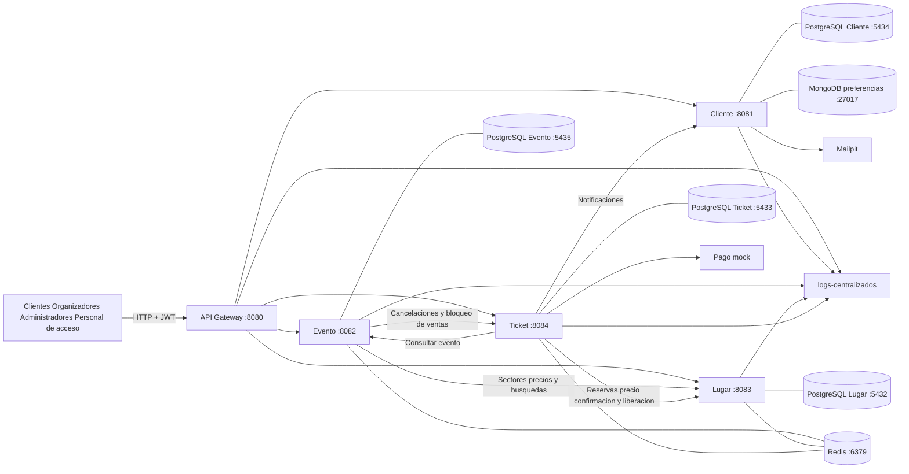
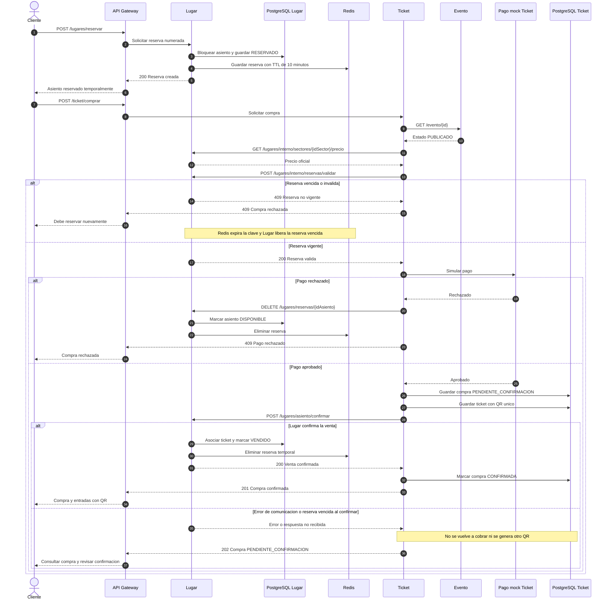
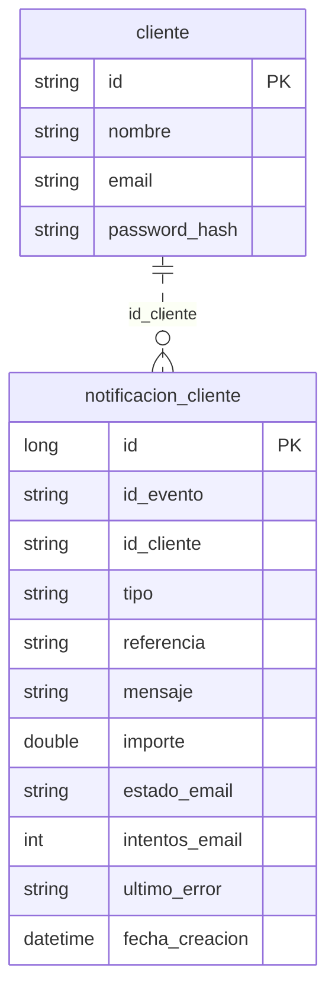
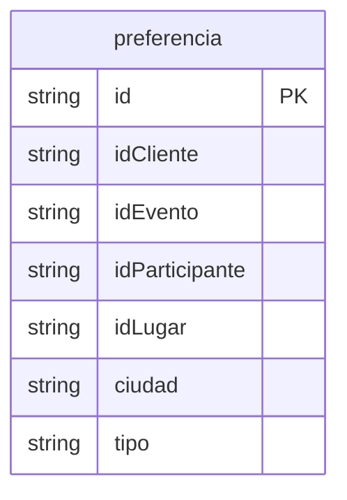
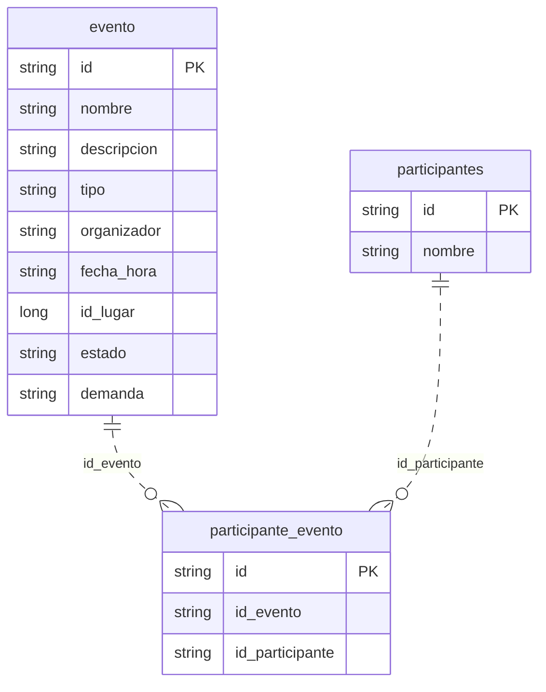
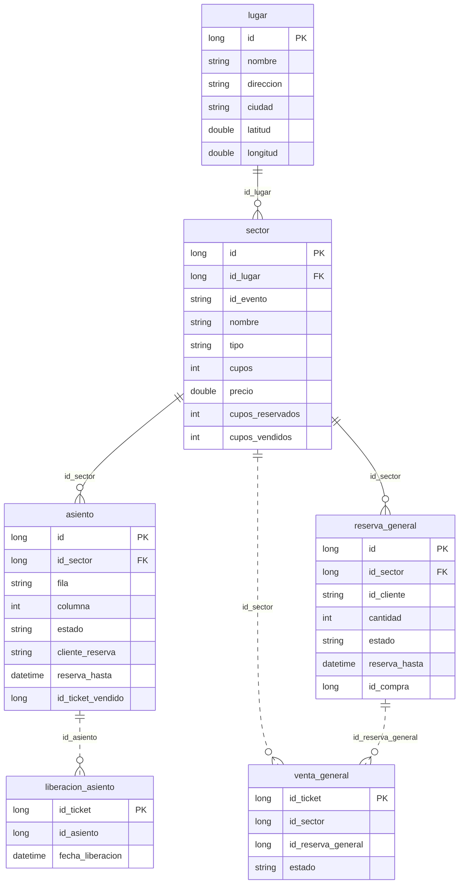
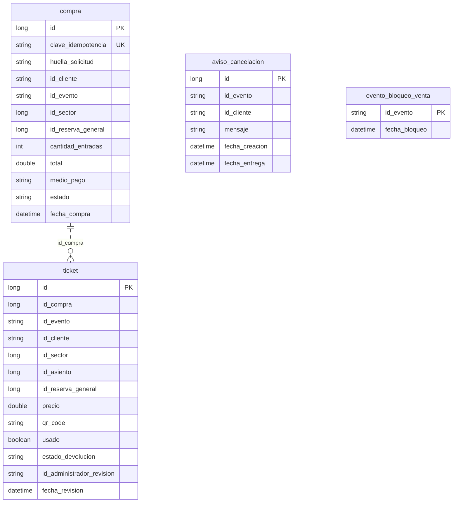

# TICKETYA

## Tabla de contenidos

1. [Instalacion y ejecucion](#instalacion-y-ejecucion)
2. [Features y User Stories](#features-y-user-stories)
3. [Arquitectura de microservicios](#arquitectura-de-microservicios)
4. [Modelo de datos](#modelo-de-datos)
5. [Diseño de API REST](#diseño-de-api-rest)
6. [OpenAPI y Swagger](#openapi-y-swagger)
7. [Testing](#testing)
8. [Metodologia de desarrollo](#metodologia-de-desarrollo)
9. [Postman y datos de prueba](#postman-y-datos-de-prueba)

# Instalacion y ejecucion

## Requisitos

- Java 17 o superior
- Maven
- Docker Desktop
- PowerShell
- Postman
- JMeter para repetir las pruebas de carga

## Configuracion

El proyecto utiliza variables de entorno para JWT seguridad interna y usuarios especiales

Crear un archivo `.env` en la carpeta `TicketYa`

Ejemplo

```env
TICKETYA_JWT_SECRET=ticketya-dev-only-change-this-jwt-secret-2026
TICKETYA_INTERNAL_KEY=ticketya-dev-only-change-this-internal-key-2026

TICKETYA_ADMIN_ID=admin-prueba
TICKETYA_ADMIN_PASSWORD=AdminPrueba2026!

TICKETYA_ORGANIZADOR_ID=TicketYa
TICKETYA_ORGANIZADOR_PASSWORD=OrganizadorPrueba2026!

TICKETYA_ACCESO_ID=acceso-prueba
TICKETYA_ACCESO_PASSWORD=AccesoPrueba2026!
```

## Levantar el sistema completo

Desde la carpeta `TicketYa`

```powershell
docker compose --profile apps up -d --build
```
> [!NOTE]
> levanta la infraestructura y los microservicios

- PostgreSQL Cliente
- PostgreSQL Evento
- PostgreSQL Lugar
- PostgreSQL Ticket
- MongoDB
- Redis
- Mailpit
- MicroServicioCliente
- MicroServicioEvento
- MicroServicioLugar
- MicroServicioTicket
- API Gateway

## Puertos

| Servicio | Puerto |
|---|---:|
| API Gateway | 8080 |
| Cliente | 8081 |
| Evento | 8082 |
| Lugar | 8083 |
| Ticket | 8084 |
| MongoDB | 27017 |
| Redis | 6379 |
| Mailpit SMTP | 1025 |
| Mailpit Web | 8025 |

Las peticiones externas se realizan mediante `http://localhost:8080`


## Bases de datos

Cada microservicio tiene su propia PostgreSQL

- Cliente `ticketya_clientes`
- Evento `ticketya_eventos`
- Lugar `ticketya_lugares`
- Ticket `ticketya_tickets`

Cliente utiliza ademas MongoDB con la base

`ticketya_preferencias`

Redis se utiliza para reservas temporales fila virtual y cache

## Logs

Los microservicios escriben automaticamente sus logs en

```text
logs-centralizados/
```

Se generan archivos separados

```text
gateway.log
cliente.log
evento.log
lugar.log
ticket.log
```

Cada request puede seguirse entre varios servicios utilizando el mismo `X-Trace-Id`

## Mailpit

Las notificaciones por email se prueban mediante Mailpit

La interfaz web se encuentra en `http://localhost:8025`

Los emails enviados por el sistema quedan visibles desde esa interfaz


# Features y User Stories

Puntos 1 al 12

Las historias siguen el formato **Como [rol] quiero [acción] para [beneficio]**

Los criterios de aceptación describen qué tiene que pasar para considerar terminada cada historia

## Features

| ID | Feature | Descripción | Punto del enunciado |
|---|---|---|---|
| F01 | Gestionar eventos | Crear y modificar eventos con sus datos y participantes | 1 |
| F02 | Configurar lugares y sectores | Registrar lugares y definir sectores y precios por evento | 2 |
| F03 | Publicar y administrar eventos | Publicar borradores y controlar el estado de los eventos | 3 |
| F04 | Reservar y comprar entradas | Reservar lugares temporalmente y confirmar compras con pago y QR | 4 |
| F05 | Evitar la doble venta | Impedir ventas duplicadas ante concurrencia o reintentos | 5 |
| F06 | Gestionar devoluciones y cancelaciones | Solicitar devoluciones y procesar reintegros individuales o masivos | 7 |
| F07 | Buscar eventos | Buscar por varios criterios y ordenar los resultados | 9 |
| F08 | Gestionar fila virtual | Ordenar el acceso a la compra en eventos de alta demanda | 6 |
| F09 | Validar ingreso al evento | Escanear el QR y evitar que una entrada se use mas de una vez | 8 |
| F10 | Preferencias y recomendaciones | Guardar gustos del cliente y sugerir eventos relacionados | 10 |
| F11 | Enviar notificaciones | Avisar compras cancelaciones cambios y eventos de interes | 11 |
| F12 | Consultar reportes | Mostrar ventas devoluciones ocupacion y recaudación por evento | 12 |

---

## F01 — Gestionar eventos

### US01 — Crear evento

**Como** organizador **quiero** crear un evento en borrador **para** configurar sus datos antes de publicarlo

**Criterios de aceptación**

- Se debe permitir ingresar nombre descripción tipo organizador fecha y hora y lugar
- Se debe generar un ID para identificar al evento
- Se debe guardar el evento en estado BORRADOR
- Se debe informar si faltan datos obligatorios o tienen un formato inválido

### US02 — Modificar borrador

**Como** organizador **quiero** editar los datos de mi evento **para** corregirlos antes de publicarlo

**Criterios de aceptación**

- Se debe permitir modificar los datos de un evento en estado BORRADOR
- Se debe verificar que el organizador corresponda al evento
- No se debe permitir editar un evento publicado mediante esta operación
- Se deben conservar los cambios realizados

### US03 — Asignar participantes

**Como** organizador **quiero** agregar participantes a mi evento **para** indicar qué artistas equipos o disertantes van a participar

**Criterios de aceptación**

- Se debe permitir registrar participantes
- Se debe permitir asociar participantes a un evento en borrador
- Se debe permitir consultar los participantes de un evento
- Se debe permitir quitar participantes antes de la publicación

## F02 — Configurar lugares y sectores

### US04 — Registrar lugar

**Como** organizador **quiero** registrar un lugar **para** indicar dónde se realizará un evento

**Criterios de aceptación**

- Se debe permitir registrar nombre dirección ciudad latitud y longitud del lugar
- Se debe generar un ID para identificar el lugar
- Se debe poder consultar los lugares registrados

### US05 — Configurar sector numerado

**Como** organizador **quiero** configurar sectores con filas y asientos **para** vender ubicaciones específicas

**Criterios de aceptación**

- Se debe permitir asociar un sector numerado a un lugar y a un evento
- Se debe permitir registrar la fila y el número o columna de cada asiento
- No se debe permitir duplicar la misma ubicación dentro de un sector
- Se debe poder consultar la disponibilidad de los asientos

### US06 — Configurar sector general

**Como** organizador **quiero** crear sectores sin asientos numerados **para** vender entradas con una capacidad máxima

**Criterios de aceptación**

- Se debe permitir crear un sector general asociado a un lugar y un evento
- Se debe definir una capacidad máxima para el sector
- El sistema no debe permitir superar esa capacidad con reservas o ventas
- Se debe poder consultar la disponibilidad del sector

### US07 — Definir precios

**Como** organizador **quiero** asignar un precio a cada sector **para** establecer cuánto cuesta la entrada de ese evento

**Criterios de aceptación**

- Se debe permitir definir un precio para cada sector asociado al evento
- El precio debe ser mayor que cero
- El precio de la compra se debe obtener del sector configurado y no del valor enviado por el cliente

## F03 — Publicar y administrar eventos

### US08 — Publicar evento

**Como** organizador **quiero** publicar un evento en borrador **para** que los clientes puedan encontrarlo y comprar entradas

**Criterios de aceptación**

- Se debe verificar que el organizador corresponda al evento
- Se debe validar que el evento tenga los datos necesarios participantes y sectores con precios
- Si cumple las condiciones debe pasar de BORRADOR a PUBLICADO
- Si faltan datos no se debe publicar y se debe informar el motivo

### US09 — Suspender o reactivar evento

**Como** administrador **quiero** suspender o reactivar un evento **para** controlar temporalmente su venta

**Criterios de aceptación**

- Se debe permitir suspender un evento que esté PUBLICADO o AGOTADO
- Se debe permitir reactivar un evento SUSPENDIDO
- No se deben permitir compras nuevas mientras el evento esté suspendido
- Se debe registrar el estado actualizado del evento

### US10 — Cancelar evento

**Como** administrador **quiero** cancelar un evento **para** impedir nuevas ventas cuando no puede realizarse

**Criterios de aceptación**

- Se debe permitir cambiar el estado del evento a CANCELADO
- No se deben permitir nuevas compras para el evento cancelado
- La cancelación debe iniciar el proceso de devolución de las entradas vendidas
- La gestión de reintegros y avisos se detalla en US21

### US11 — Marcar agotado o finalizado

**Como** administrador **quiero** actualizar un evento a AGOTADO o FINALIZADO **para** reflejar su situación

**Criterios de aceptación**

- Se debe permitir marcar como AGOTADO un evento publicado
- Se debe permitir finalizar un evento publicado o agotado cuando su fecha ya haya pasado
- Se debe guardar el estado actualizado
- Los eventos que no estén publicados no deben admitir compras nuevas

## F04 — Reservar y comprar entradas

### US12 — Reservar asientos numerados

**Como** cliente **quiero** reservar asientos específicos **para** mantenerlos disponibles mientras realizo el pago

**Criterios de aceptación**

- Se debe verificar que cada asiento esté disponible
- Se debe reservar temporalmente por 10 minutos
- Otro cliente no debe poder reservar el mismo asiento durante ese plazo
- Si la reserva vence el asiento debe volver a estar disponible

### US13 — Reservar cupos generales

**Como** cliente **quiero** reservar entradas de un sector general **para** asegurar mis lugares mientras pago

**Criterios de aceptación**

- Se debe verificar que queden cupos disponibles
- La reserva debe tener un vencimiento temporal
- Las reservas vigentes deben descontarse de la disponibilidad
- Cuando la reserva se libera o vence los cupos deben recuperarse

### US14 — Comprar entradas y recibir QR

**Como** cliente **quiero** pagar mis entradas **para** obtener los tickets que necesito para asistir al evento

**Criterios de aceptación**

- Se debe permitir comprar entradas numeradas o generales de un evento PUBLICADO
- El pago debe realizarse mediante la pasarela simulada
- Si el pago se aprueba se debe confirmar la compra y registrar el medio de pago
- Se debe emitir un ticket con un código QR único por entrada
- Se debe guardar el detalle de la compra y permitir consultarlo

### US15 — Manejar pago rechazado o reserva vencida

**Como** cliente **quiero** que el sistema informe si mi compra no pudo completarse **para** saber si debo intentar nuevamente

**Criterios de aceptación**

- Si el pago es rechazado no se deben emitir entradas
- Los asientos o cupos reservados deben liberarse ante un rechazo
- Si la reserva venció no se debe confirmar la venta
- Se debe informar que la operación no pudo completarse

### US16 — Respetar el límite de entradas

**Como** administrador **quiero** limitar cuántas entradas compra un cliente por evento **para** evitar compras excesivas

**Criterios de aceptación**

- Se debe contabilizar la cantidad de entradas activas del cliente para el mismo evento
- Se debe rechazar una compra que supere el límite configurado
- Se debe aplicar la regla tanto a entradas numeradas como generales
- No se debe modificar el stock cuando la compra es rechazada por superar el límite

## F05 — Evitar la doble venta

### US17 — Comprar sin doble venta

**Como** cliente **quiero** que mis entradas se asignen de manera segura **para** no recibir una ubicación vendida a otra persona

**Criterios de aceptación**

- Si varios clientes intentan reservar el mismo asiento solo uno debe conseguirlo
- Si varios clientes intentan comprar el último cupo general no se debe superar la capacidad
- Un asiento vendido no debe poder venderse otra vez
- Se debe mantener la protección con compras simultáneas mediante la base de datos

### US18 — Reintentar una compra

**Como** cliente **quiero** reintentar una compra interrumpida **para** conocer su resultado sin pagar dos veces

**Criterios de aceptación**

- Se debe poder identificar una compra repetida mediante una clave de idempotencia
- Repetir la misma operación no debe generar tickets duplicados
- Se debe permitir recuperar el estado de una compra que quedó pendiente de confirmación
- Si la compra ya fue confirmada se debe devolver su resultado sin realizar un nuevo cobro

## F06 — Gestionar devoluciones y cancelaciones

### US19 — Solicitar devolución

**Como** cliente **quiero** solicitar la devolución de una entrada **para** recuperar el dinero si no puedo asistir

**Criterios de aceptación**

- Se debe verificar que la entrada pertenezca al cliente indicado
- Se debe permitir solicitar la devolución hasta 72 horas antes del evento
- Si faltan menos de 72 horas se debe rechazar la solicitud
- La solicitud aceptada debe quedar pendiente de revisión

### US20 — Revisar devolución

**Como** administrador **quiero** aprobar o rechazar una solicitud de devolución **para** resolver el pedido del cliente

**Criterios de aceptación**

- Se debe permitir revisar una solicitud pendiente
- El administrador debe poder aprobarla o rechazarla
- Si se aprueba se debe solicitar el reintegro a la pasarela simulada
- Una vez reintegrado el importe se debe liberar el asiento o cupo general
- Si se rechaza la entrada debe conservar su venta

### US21 — Reintegrar entradas por cancelación

**Como** administrador **quiero** que se reintegren las entradas de un evento cancelado **para** devolver el dinero a sus compradores

**Criterios de aceptación**

- Se debe impedir que continúen las compras después de cancelar el evento
- Se deben procesar los reintegros de las entradas vendidas
- Se deben liberar los asientos y cupos cuando corresponda
- Se debe registrar un aviso de cancelación por comprador
- Se debe entregar el aviso a la bandeja interna de cada cliente
- Si un reintegro o aviso falla se debe poder reintentar sin generar duplicados

## F07 — Buscar eventos

### US22 — Buscar con varios criterios

**Como** cliente **quiero** buscar eventos usando filtros **para** encontrar los que me interesan

**Criterios de aceptación**

- Se debe permitir filtrar por tipo de evento organizador y participante
- Se debe permitir filtrar por ciudad y rango de fechas
- Se debe permitir combinar varios filtros en una misma búsqueda
- Se deben mostrar solo los eventos disponibles para consulta pública
- Si no existen coincidencias se debe devolver una lista vacía

### US23 — Ordenar resultados

**Como** cliente **quiero** ordenar los eventos encontrados **para** comparar las opciones de compra

**Criterios de aceptación**

- Se debe permitir ordenar los resultados por fecha
- Se debe permitir ordenar por precio según los sectores del evento
- Se debe permitir ordenar por relevancia según la búsqueda
- El ordenamiento debe funcionar también cuando se usan varios filtros

## F08 — Gestionar fila virtual

### US24 — Ingresar a la fila virtual

**Como** cliente **quiero** ingresar a una fila virtual **para** esperar mi turno cuando un evento tiene mucha demanda

**Criterios de aceptación**

- La fila se utiliza para eventos marcados como de alta demanda
- Cada cliente debe tener una posicion dentro de la fila
- El sistema debe informar la posición actual
- Un cliente no debe poder ingresar varias veces a la misma fila

### US25 — Habilitar clientes por tandas

**Como** cliente **quiero** ser habilitado cuando llega mi turno **para** poder realizar la compra

**Criterios de aceptación**

- Los clientes deben habilitarse respetando el orden de llegada
- La habilitación se realiza por tandas
- Un cliente no habilitado no debe poder continuar con la compra
- La fila debe avanzar cuando los clientes habilitados completan su proceso

## F09 — Validar ingreso al evento

### US26 — Escanear entrada

**Como** personal de acceso **quiero** escanear el QR de una entrada **para** verificar que sea valida para el evento

**Criterios de aceptación**

- El QR debe corresponder a una entrada existente
- La entrada debe pertenecer al evento indicado
- La entrada no debe haber sido utilizada anteriormente
- Solo PERSONAL_ACCESO o ADMINISTRADOR pueden realizar esta operación

### US27 — Evitar reutilizar una entrada

**Como** personal de acceso **quiero** marcar una entrada como utilizada **para** impedir que el mismo QR ingrese dos veces

**Criterios de aceptación**

- Una entrada válida se debe marcar como utilizada luego del ingreso
- Un QR utilizado anteriormente debe ser rechazado
- La validación debe conservar el estado de uso de la entrada

## F10 — Preferencias y recomendaciones

### US28 — Guardar preferencias

**Como** cliente **quiero** guardar mis preferencias **para** que el sistema conozca los eventos que me interesan

**Criterios de aceptación**

- Se deben poder guardar tipos de evento artistas favoritos y ciudad
- Las preferencias deben quedar asociadas al cliente
- Las preferencias se guardan en MongoDB
- El cliente debe poder actualizar sus gustos

### US29 — Obtener recomendaciones

**Como** cliente **quiero** recibir recomendaciones de eventos **para** encontrar opciones relacionadas con mis gustos

**Criterios de aceptación**

- Las recomendaciones deben utilizar las preferencias guardadas
- Se deben priorizar eventos relacionados con tipos artistas o ciudad del cliente
- Si no existen coincidencias se puede devolver una lista vacia
- La implementación utiliza una recomendación simplificada basada en preferencias

## F11 — Enviar notificaciones

### US30 — Notificar una compra

**Como** cliente **quiero** recibir una notificacion cuando confirmo una compra **para** saber que mis entradas fueron emitidas

**Criterios de aceptación**

- Una compra confirmada debe generar una notificación
- La notificación debe identificar el evento y la compra
- Se intenta enviar el aviso por email
- Si el cliente no tiene email el aviso interno igualmente debe quedar registrado

### US31 — Notificar cambios y cancelaciones

**Como** cliente **quiero** recibir avisos sobre cambios o cancelaciones **para** conocer el estado de mis eventos

**Criterios de aceptación**

- Una cancelación debe generar un aviso para los compradores afectados
- Los avisos deben quedar registrados
- Si una entrega falla se debe poder reintentar
- Un reintento no debe generar notificaciones duplicadas

### US32 — Avisar por artistas favoritos

**Como** cliente **quiero** recibir un aviso cuando se publica un evento de un artista que sigo **para** enterarme de nuevos eventos en mi ciudad

**Criterios de aceptación**

- Se deben consultar las preferencias del cliente
- El artista debe estar entre sus favoritos
- El evento debe corresponder a la ciudad configurada
- El aviso se genera cuando el evento es publicado

## F12 — Consultar reportes

### US33 — Consultar reporte de evento

**Como** organizador **quiero** consultar un reporte de mis eventos **para** conocer como vienen las ventas

**Criterios de aceptación**

- Solo el organizador correspondiente puede consultar el reporte de su evento
- El reporte debe mostrar entradas vendidas y devueltas por sector
- Debe mostrar la ocupacion de cada sector
- Debe mostrar recaudacion bruta reintegros y recaudación neta
- También debe mostrar los totales generales del evento

# Arquitectura de microservicios

Desarrollo con microservicios Spring Boot independientes

Cada microservicio tiene su propio proyecto Maven su API REST y su persistencia

El acceso externo se realiza mediante el API Gateway en el puerto 8080

Las operaciones privadas utilizan JWT con los roles CLIENTE ORGANIZADOR ADMINISTRADOR y PERSONAL_ACCESO

## 1. Microservicios y responsabilidades

| Microservicio | Puerto | Responsabilidad |
|---|---|---|
| API Gateway | 8080 | Recibir las peticiones externas validar y propagar la seguridad y dirigir cada request al servicio correspondiente |
| Cliente | 8081 | Gestionar clientes autenticacion preferencias recomendaciones y notificaciones |
| Evento | 8082 | Gestionar eventos participantes publicación estados busquedas y cache del catalogo |
| Lugar | 8083 | Gestionar lugares sectores precios asientos reservas y disponibilidad |
| Ticket | 8084 | Gestionar compras pagos QR devoluciones fila virtual reportes y cancelaciones |

**Persistencia**

| Servicio | Persistencia |
|---|---|
| Cliente | PostgreSQL `ticketya_clientes` y MongoDB `ticketya_preferencias` |
| Evento | PostgreSQL `ticketya_eventos` y Redis para cache |
| Lugar | PostgreSQL `ticketya_lugares` y Redis para reservas temporales |
| Ticket | PostgreSQL `ticketya_tickets` y Redis para fila virtual |

Las cuatro bases PostgreSQL son independientes y cada una pertenece a su microservicio

MongoDB se utiliza para las preferencias de los clientes en la base `ticketya_preferencias` y la coleccion `preferencias`

Redis es compartido entre los servicios que necesitan datos temporales

Lugar guarda reservas de asientos con un TTL de 10 minutos

Ticket utiliza Redis para mantener el orden y la habilitacion de la fila virtual

Tambien se utiliza Redis para cachear el catalogo y resultados de busqueda con un TTL de 5 minutos

Los datos de disponibilidad no se guardan en cache para evitar mostrar stock viejo

Los pagos utilizan un mock dentro de Ticket

Las notificaciones por email utilizan Mailpit durante la ejecución local

## 2. API pública

Las siguientes rutas muestran las operaciones principales de cada microservicio

### Cliente

| Método | Ruta | Función |
|---|---|---|
| POST | `/clientes` | Crear cliente |
| GET | `/clientes/{id}` | Consultar cliente |
| POST | `/clientes/preferencias` | Guardar preferencias |
| GET | `/clientes/{id}/notificaciones` | Consultar avisos del cliente |
| POST | `/clientes/login` | Iniciar sesion y obtener JWT |
| PATCH | `/clientes/{id}/email` | Registrar o actualizar email |
| GET | `/clientes/{id}/recomendaciones` | Obtener recomendaciones del cliente |

### Evento

| Método | Ruta | Función |
|---|---|---|
| POST | `/evento` | Crear evento en borrador |
| PUT | `/evento/{id}?idOrganizador=...` | Modificar borrador |
| PUT | `/evento/{id}/estado?idOrganizador=...` | Publicar evento |
| PATCH | `/evento/{id}/suspender?idAdministrador=...` | Suspender evento |
| PATCH | `/evento/{id}/reactivar?idAdministrador=...` | Reactivar evento |
| PATCH | `/evento/{id}/cancelar?idAdministrador=...` | Cancelar evento |
| POST | `/evento/{id}/reintentar-cancelacion?idAdministrador=...` | Reintentar reintegros y avisos pendientes |
| PATCH | `/evento/{id}/agotar?idAdministrador=...` | Marcar agotado |
| PATCH | `/evento/{id}/finalizar?idAdministrador=...` | Finalizar evento |
| GET | `/evento` | Listar eventos publicados |
| GET | `/evento/{id}` | Consultar evento por ID |
| GET | `/evento/buscar` | Buscar por tipo organizador participante ciudad fechas y orden |
| POST | `/evento/participantes` | Registrar participante |
| GET | `/evento/participantes` | Listar participantes |
| GET | `/evento/{idEvento}/participantes` | Consultar participantes del evento |
| POST | `/evento/{idEvento}/participantes/{idParticipante}?idOrganizador=...` | Asociar participante |
| DELETE | `/evento/{idEvento}/participantes/{idParticipante}?idOrganizador=...` | Quitar participante |

### Lugar

| Método | Ruta | Función |
|---|---|---|
| POST | `/lugares` | Registrar lugar |
| GET | `/lugares` | Listar lugares |
| PATCH | `/lugares/{idLugar}/ciudad?ciudad=...` | Actualizar ciudad |
| GET | `/lugares/buscarPorCiudad?ciudad=...` | Buscar lugares por ciudad |
| GET | `/lugares/buscarPorUbicacion?lat=...&lon=...` | Buscar por coordenadas |
| POST | `/lugares/sectores` | Crear sector numerado o general |
| POST | `/lugares/asientos` | Crear asiento de un sector numerado |
| POST | `/lugares/reservar` | Reservar asiento numerado por 10 minutos |
| DELETE | `/lugares/reservas/{idAsiento}?idCliente=...` | Cancelar reserva numerada |
| GET | `/lugares/sectores/{idSector}/disponibilidad` | Consultar cupos generales libres |
| POST | `/lugares/sectores/generales/reservar` | Reservar cupos generales |
| DELETE | `/lugares/sectores/generales/reservas/{idReserva}?idSector=...&idCliente=...` | Cancelar reserva general |

### Ticket

| Método | Ruta | Función |
|---|---|---|
| POST | `/ticket/comprar` | Comprar entradas numeradas |
| POST | `/ticket/emitir` | Ruta alternativa para comprar entradas numeradas |
| POST | `/ticket/comprar-general` | Comprar entradas generales |
| GET | `/ticket/compras/{idCompra}` | Consultar compra y tickets |
| POST | `/ticket/compras/{idCompra}/reintentar` | Reintentar confirmación sin volver a cobrar |
| GET | `/ticket/{id}` | Consultar entrada |
| POST | `/ticket/{id}/solicitar-devolucion?idCliente=...` | Solicitar devolución |
| PATCH | `/ticket/{id}/revisar-devolucion?idAdministrador=...&decision=...` | Aprobar o rechazar devolución |
| PATCH | `/ticket/{id}/procesar-reintegro` | Procesar reintegro simulado |
| PATCH | `/ticket/{id}/finalizar-devolucion` | Completar devolución y liberar lugar |
| GET | `/ticket/eventos/{idEvento}/estado-cancelacion` | Consultar avance de reintegros y avisos |
| GET | `/ticket/avisos-cancelacion?idCliente=...` | Consultar avisos registrados en Ticket |
| POST | `/ticket/cola/{idEvento}/entrar` | Ingresar a la fila virtual |
| GET | `/ticket/cola/{idEvento}/posicion?idCliente=...` | Consultar posicion en la fila |
| POST | `/ticket/escanearQrcode?qrCode=...&idEvento=...` | Validar ingreso mediante QR |
| GET | `/ticket/reportes/eventos/{idEvento}?idOrganizador=...` | Consultar reporte del evento |

Las rutas `/interno/` se usan para la comunicación entre microservicios

**Seguridad**

Las operaciones privadas utilizan JWT

Cada token identifica al usuario y su rol

Los roles utilizados son CLIENTE ORGANIZADOR ADMINISTRADOR y PERSONAL_ACCESO

El Gateway recibe las peticiones y los servicios verifican los permisos necesarios para cada operacion

## 3. Diagrama de módulos



Las peticiones externas ingresan por el Gateway

Los servicios se comunican principalmente mediante HTTP REST

Cada microservicio mantiene sus propios datos y cuando necesita informacion de otro servicio realiza una llamada REST

Los ID de eventos clientes sectores lugares compras y tickets se comparten como referencias pero no se utilizan FK entre bases de distintos microservicios

Todas las solicitudes generan un X-Trace-Id

El mismo identificador se propaga entre los servicios y permite seguir una operación completa en los logs

Los logs se escriben automaticamente en la carpeta logs-centralizados

## 4. Diagrama de secuencia — Compra de entrada numerada

El cliente primero reserva el asiento en Lugar y después solicita la compra en Ticket

Ticket consulta a Evento para verificar el estado PUBLICADO y a Lugar para conocer el precio oficial y validar la reserva



Pago rechazado: Ticket solicita liberar el asiento reservado, si Lugar no responde queda pendiente la limpieza de reservas vencidas

Reserva vencida antes del pago: Lugar rechaza la validación y no se procesa el pago, el asiento vuelve a estar disponible mediante el control de vencimiento y la limpieza periódica

Error después de aprobar el pago: Ticket conserva la compra como `PENDIENTE_CONFIRMACION` porque Lugar podría haber confirmado la venta aunque su respuesta se perdiera. La confirmación se puede revisar y reintentar sin repetir el pago

## 5. Concurrencia consistencia y fallos parciales

### Consistencia fuerte

Se utiliza consistencia fuerte en las operaciones donde no se pueden aceptar datos desactualizados

Lugar controla reservas cupos y ventas mediante PostgreSQL

Los bloqueos y restricciones de la base evitan que dos clientes puedan vender el mismo asiento o superar la capacidad de un sector

Ticket utiliza claves de idempotencia para reconocer reintentos y evitar compras o cobros duplicados

La prueba con dos instancias de Lugar compartiendo la misma PostgreSQL verificó que al intentar reservar el ultimo cupo solamente una instancia pudo obtenerlo

### Consistencia eventual

Algunas operaciones no necesitan completarse en la misma transaccion

Las notificaciones pueden enviarse despues de completar una compra o cancelacion

Si el email falla la notificación queda guardada y puede volver a intentarse

Los logs y datos de seguimiento tambien se generan de forma independiente de la operacion principal

Esto permite que una falla secundaria no invalide una compra que ya fue confirmada correctamente

### Fallos durante una compra

Una compra utiliza Ticket Evento y Lugar por lo que no existe una unica transaccion que abarque todo el proceso

Si la reserva no es válida o esta vencida la compra se rechaza antes de realizar el pago

Si el pago es rechazado Ticket solicita liberar la reserva

Si el pago fue aprobado pero Lugar no puede confirmar la venta la compra queda en estado `PENDIENTE_CONFIRMACION`

En ese estado el cliente puede consultar o reintentar la confirmacion sin volver a realizar el pago ni generar nuevos tickets

Si Lugar habia confirmado pero la respuesta se perdió el reintento puede recuperar el resultado sin duplicar la venta

Las cancelaciones siguen una estrategia similar

Primero se bloquean nuevas ventas y despues se procesan reintegros liberaciones y notificaciones

Si alguno de estos pasos falla se conserva su estado para poder reintentarlo sin repetir los pasos que ya fueron completados

## 6. Decisiones tecnologicas y patrones

### PostgreSQL

Se utiliza PostgreSQL para los datos principales de Cliente Evento Lugar y Ticket

Estos datos necesitan transacciones restricciones y consistencia fuerte

Cada microservicio tiene su propia base y no accede directamente a la base de otro servicio

### MongoDB

MongoDB se utiliza para guardar las preferencias de los clientes

Se eligio porque las preferencias pueden cambiar y no necesitan la misma estructura relacional que una compra o una entrada

Permite guardar estos datos como documentos y mantenerlos separados de la informacion principal del cliente

### Redis

Redis se utiliza para informacion temporal y de acceso rapido

Se usa para las reservas con vencimiento la fila virtual y el cache

Las reservas tienen TTL para que desaparezcan luego del tiempo definido

Tambien permite mantener el orden de la fila sin guardar esos datos como informacion permanente

### API Gateway

Se utiliza un API Gateway como unico punto de entrada al sistema

El cliente no necesita conocer los puertos ni la ubicacion de cada microservicio

El Gateway recibe la petición y la dirige al servicio correspondiente

Tambien permite mantener en un solo punto tareas comunes como el JWT y del X-Trace-Id

### Circuit Breaker

Las comunicaciones entre servicios pueden fallar o tardar demasiado

Por eso se utilizan timeouts reintentos y Circuit Breaker

Si un servicio deja de responder se evita continuar haciendo llamadas que probablemente fallen

Cuando no se puede completar una llamada el sistema devuelve un error controlado como 503 en lugar de quedar esperando indefinidamente

### Saga y compensaciones

No existe una sola transaccion que incluya las bases de todos los microservicios

Por eso las operaciones distribuidas se manejan como una secuencia de pasos

Si uno falla se realiza una operacion de compensacion cuando corresponde

Por ejemplo si el pago es rechazado se libera la reserva

Si el pago fue aprobado pero no se puede confirmar con Lugar la compra queda PENDIENTE_CONFIRMACION y se puede reintentar sin volver a cobrar

Este comportamiento sigue una idea similar al patron Saga mediante compensaciones

## 7. Ejecución local

La infraestructura los cuatro microservicios y el API Gateway se levantan mediante Docker Compose

Desde la carpeta `TicketYa`

```powershell
docker compose --profile apps up -d --build
```

El detalle completo de configuracion puertos y servicios se encuentra en la sección Instalacion y ejecucion

# Modelo de datos

## 1. Microservicio Cliente

Cliente utiliza PostgreSQL para los clientes y notificaciones

Las preferencias se almacenan aparte en MongoDB

### PostgreSQL



`cliente` guarda los datos necesarios para identificar y autenticar al usuario

La contraseña no se guarda directamente se almacena su hash

`notificacion_cliente` guarda los avisos generados para cada cliente

Tambien mantiene el estado del envio por email los intentos y el ultimo error para poder reintentar

### Preferencias MongoDB

Base de datos `ticketya_preferencias`

Coleccion `preferencias`



Las preferencias se guardan como documentos y no como tablas

`idCliente` referencia al cliente dueño de la preferencia pero no existe una FK entre MongoDB y PostgreSQL

Los campos pueden guardar eventos participantes lugares ciudad y tipo de evento

Estos datos se utilizan para generar recomendaciones y detectar eventos relacionados con los gustos del cliente

## 2. Microservicio Evento

Guarda los datos del evento los participantes y las asociaciones entre ambos



- `evento.id` `participantes.id` y `participante_evento.id` son String
- `participante_evento` representa la relación de muchos a muchos entre eventos y participantes
- `id_evento` e `id_participante` tiene una restricción de unicidad en la base migrada
- `evento.id_lugar` referencia un lugar del microservicio Lugar
- `fecha_hora` se almacena como texto según la entidad Java actual
- Las asociaciones se guardan mediante IDs sin relaciones JPA ni claves foráneas declaradas

## 3. Microservicio Lugar

Guarda lugares sectores asientos reservas numeradas y generales y los registros de venta y liberación



- Un lugar puede tener varios sectores
- Cada sector se configura para un evento mediante `id_evento` y guarda su precio y tipo `NUMERADO` o `NO_NUMERADO`
- Los asientos pertenecen a un sector numerado y registran estado cliente que reservó y vencimiento
- `reserva_general` registra la cantidad reservada el cliente y el vencimiento
- `venta_general` guarda las ventas generales por ID de ticket y evita registrar dos veces el mismo ticket
- `liberacion_asiento` registra una liberación por ID de ticket
- Las relaciones `sector → lugar` `asiento → sector` y `reserva_general → sector` usan FK locales por los mapeos JPA
- Las demás relaciones del diagrama se realizan mediante IDs sin FK declarada

> [!WARNING]
> Restricción importante: existe un indice unico por sector fila normalizada y columna para impedir asientos físicos duplicados

## 4. Microservicio Ticket

Guarda las compras las entradas y los avisos de cancelación, también mantiene un bloqueo de venta para eventos cancelados



- Una compra puede generar varios ticket, se relacionan mediante `ticket.id_compra`
- `clave_idempotencia` es unica para reconocer reintentos de una compra
- Cada ticket tiene su QR y registra el estado de su devolución
- `ticket.id_asiento` es opcional porque las entradas generales no tienen asiento numerado
- `aviso_cancelacion` registra un aviso por cliente y evento
- `fecha_entrega` indica si el aviso ya se entregó al microservicio Cliente
- `evento_bloqueo_venta` evita nuevas compras después de cancelar un evento
- `compra` y `ticket` se relacionan por ID sin una FK declarada en las entidades Java

> [!WARNING]
> Restricción importante: Ticket tiene un indice unico sobre `id_asiento` para impedir más de un ticket activo por asient, los tickets con estado `DEVUELTA` quedan fuera de ese indice

## 5. Relaciones entre microservicios

Cada servicio guarda los ID necesarios y consulta por REST cuando necesita datos externos

| Dato de origen | Referencia | Servicio dueño del dato |
|---|---|---|
| `evento.id_lugar` | `lugar.id` | Lugar |
| `sector.id_evento` | `evento.id` | Evento |
| `compra.id_cliente` y `ticket.id_cliente` | `cliente.id` | Cliente |
| `compra.id_evento` y `ticket.id_evento` | `evento.id` | Evento |
| `compra.id_sector` y `ticket.id_sector` | `sector.id` | Lugar |
| `ticket.id_asiento` | `asiento.id` | Lugar |
| `reserva_general.id_compra` | `compra.id` | Ticket |
| `venta_general.id_ticket` y `liberacion_asiento.id_ticket` | `ticket.id` | Ticket |
| `preferencias.id_evento` | `evento.id` | Evento |
| `preferencias.id_participante` | `participantes.id` | Evento |
| `preferencias.id_lugar` | `lugar.id` | Lugar |
| `aviso_cancelacion.id_cliente` y `notificacion_cliente.id_cliente` | `cliente.id` | Cliente |

## Datos temporales en Redis

Redis no reemplaza las bases principales

Se utiliza solamente para informacion temporal y cache

- Reservas numeradas con vencimiento de 10 minutos
- Fila virtual de eventos de alta demanda
- Posicion y habilitacion de clientes dentro de la fila
- Cache del catalogo y resultados de busqueda con TTL de 5 minutos

Los datos de compras entradas eventos y disponibilidad siguen guardados en PostgreSQL

No se guarda la disponibilidad de sectores en cache porque puede cambiar durante una compra

## 6. Datos solapados entre bases

No se duplican tablas completas de Cliente Evento o Lugar en otros microservicios, se repiten algunos ID para poder realizar las operaciones

- Evento: Se administra en Evento, pero Lugar y Ticket guardan `id_evento`
- Cliente: Se administra en Cliente, pero Ticket y Lugar guardan `id_cliente`
- Sector y asiento: la disponibilidad pertenece a Lugar, pero Ticket guarda sus ID para registrar la entrada vendida
- Cancelación: Ticket guarda `aviso_cancelacion` y Cliente guarda `notificacion_cliente`, ambas tablas comparten `id_evento` `id_cliente` y el mensaje, pero Ticket registra el control de entrega y Cliente conserva el aviso para mostrarlo al comprador

# Diseño de API REST

## 1. Microservicio Cliente

Gestiona los clientes sus preferencias y las notificaciones internas por cancelacion

| Metodo | Ruta | Parametros o body | Respuesta | Codigos |
|---|---|---|---|---|
| POST | `/clientes` | JSON con `nombre` | Cliente creado | 201 |
| GET | `/clientes/{id}` | `id` String por ruta | Cliente encontrado | 200, 404 |
| POST | `/clientes/preferencias` | JSON con `idCliente` `idEvento` `idParticipante` `idLugar` | Preferencia guardada | 201 |
| GET | `/clientes/{id}/notificaciones` | `id` String por ruta | Lista de notificaciones | 200 |
| POST | `/clientes/login` | JSON con `idUsuario` y `password` | JWT y rol | 200, 401 |
| PATCH | `/clientes/{id}/email` | `id` String y JSON con `email` | Cliente actualizado | 200, 400, 401, 403 |
| GET | `/clientes/{id}/recomendaciones` | `id` String por ruta | Lista de eventos recomendados | 200, 400, 401, 403, 404, 503 |

### Ejemplos

Crear cliente

`POST /clientes`

Request

```json
{
  "nombre": "Juan Perez"
}
```

Response `201`

```json
{
  "id": "550e8400-e29b-41d4-a716-446655440000",
  "nombre": "Juan Perez"
}
```

Guardar preferencias

`POST /clientes/preferencias`

Request

```json
{
  "idCliente": "550e8400-e29b-41d4-a716-446655440000",
  "idEvento": "evento-ejemplo",
  "idParticipante": "participante-ejemplo",
  "idLugar": "1"
}
```

Response `201`, se devuelve la preferencia con su `id` generado

```json
{
  "id": "c4d325f9-b84d-4976-85a0-cef81d28f613",
  "idCliente": "550e8400-e29b-41d4-a716-446655440000",
  "idEvento": "evento-ejemplo",
  "idParticipante": "participante-ejemplo",
  "idLugar": "1"
}
```

Consultar notificaciones

`GET /clientes/550e8400-e29b-41d4-a716-446655440000/notificaciones`

Response `200`

```json
[
  {
    "id": 1,
    "idEvento": "evento-ejemplo",
    "idCliente": "550e8400-e29b-41d4-a716-446655440000",
    "mensaje": "El evento fue cancelado",
    "fechaCreacion": "2026-11-10T19:00:00Z"
  }
]
```

Si no hay notificaciones se devuelve `[]`

## 2. Microservicio Evento

Permite crear eventos modificar borradores administrar estados participantes y realizar busquedas

| Metodo | Ruta | Parametros o body | Respuesta | Codigos |
|---|---|---|---|---|
| POST | `/evento` | JSON con datos del evento | Evento en BORRADOR | 201, 400 |
| PUT | `/evento/{id}` | `id` String `idOrganizador` query y JSON con cambios | Borrador actualizado | 200, 400, 403, 404, 409 |
| PUT | `/evento/{id}/estado` | `id` String `idOrganizador` query | Evento PUBLICADO | 200, 400, 403, 404, 409, 502, 503 |
| PATCH | `/evento/{id}/suspender` | `id` String `idAdministrador` query | Evento SUSPENDIDO | 200, 400, 404, 409 |
| PATCH | `/evento/{id}/reactivar` | `id` String `idAdministrador` query | Evento PUBLICADO | 200, 400, 404, 409 |
| PATCH | `/evento/{id}/cancelar` | `id` String `idAdministrador` query | Evento CANCELADO | 200, 400, 404, 409 |
| POST | `/evento/{id}/reintentar-cancelacion` | `id` String `idAdministrador` query | Estado de reintegros y avisos | 200, 400, 404, 409 |
| PATCH | `/evento/{id}/agotar` | `id` String `idAdministrador` query | Evento AGOTADO | 200, 400, 404, 409 |
| PATCH | `/evento/{id}/finalizar` | `id` String `idAdministrador` query | Evento FINALIZADO | 200, 400, 404, 409 |
| GET | `/evento` | Sin parametros | Lista publica de eventos | 200 |
| GET | `/evento/{id}` | `id` String por ruta | Evento por ID | 200, 404 |
| POST | `/evento/participantes` | JSON con `nombre` | Participante creado | 201, 400 |
| GET | `/evento/participantes` | Sin parametros | Lista de participantes | 200 |
| POST | `/evento/{idEvento}/participantes/{idParticipante}` | Ambos ID por ruta y `idOrganizador` query | Asociacion guardada | 200, 400, 403, 404, 409 |
| DELETE | `/evento/{idEvento}/participantes/{idParticipante}` | Ambos ID por ruta y `idOrganizador` query | Sin contenido | 204, 400, 403, 404, 409 |
| GET | `/evento/{idEvento}/participantes` | `idEvento` String por ruta | Participantes del evento | 200, 404 |
| GET | `/evento/buscar` | Filtros opcionales por query | Eventos con `precioDesde` | 200, 400, 502, 503 |


### Parametros de busqueda

| Parametro | Tipo | Uso |
|---|---|---|
| `tipo` | String | Filtrar por tipo de evento |
| `organizador` | String | Filtrar por organizador |
| `participante` | String | Buscar por nombre de participante |
| `ciudad` | String | Filtrar por ciudad del lugar |
| `fechaDesde` | String `yyyy-MM-dd` | Fecha inicial incluida |
| `fechaHasta` | String `yyyy-MM-dd` | Fecha final incluida |
| `texto` | String | Buscar en nombre descripcion tipo organizador y participantes |
| `q` | String | Alias de `texto` |
| `lat` y `lon` | Double | Filtrar por ubicacion |
| `ordenarPor` | String | `fecha` `precio` o `relevancia` |

### Ejemplos

Crear evento

`POST /evento`

Request

```json
{
  "nombre": "Festival de verano",
  "descripcion": "Festival de musica en Tandil",
  "tipo": "RECITAL",
  "organizador": "organizador-01",
  "fechaHora": "2026-12-15T21:00:00",
  "idLugar": 1,
  "demanda": "NORMAL"
}
```

Response `201`, campos principales

```json
{
  "id": "evento-ejemplo",
  "nombre": "Festival de verano",
  "descripcion": "Festival de musica en Tandil",
  "tipo": "RECITAL",
  "organizador": "organizador-01",
  "fechaHora": "2026-12-15T21:00:00",
  "idLugar": 1,
  "estado": "BORRADOR",
  "demanda": "NORMAL"
}
```

Publicar evento

`PUT /evento/evento-ejemplo/estado?idOrganizador=organizador-01`

Sin body, si el evento cumple las validaciones responde `200` con el mismo evento y `estado: "PUBLICADO"`

Registrar participante

`POST /evento/participantes`

Request

```json
{
  "nombre": "Banda invitada"
}
```

Response `201`

```json
{
  "id": "participante-ejemplo",
  "nombre": "Banda invitada"
}
```

Asociar participante

`POST /evento/evento-ejemplo/participantes/participante-ejemplo?idOrganizador=organizador-01`

Response `200`

```json
{
  "id": "asociacion-ejemplo",
  "idEvento": "evento-ejemplo",
  "idParticipante": "participante-ejemplo"
}
```

Buscar eventos

`GET /evento/buscar?tipo=RECITAL&ciudad=Tandil&ordenarPor=precio`

Response `200`

```json
[
  {
    "id": "evento-ejemplo",
    "nombre": "Festival de verano",
    "descripcion": "Festival de musica en Tandil",
    "tipo": "RECITAL",
    "organizador": "organizador-01",
    "fechaHora": "2026-12-15T21:00:00",
    "idLugar": 1,
    "estado": "PUBLICADO",
    "demanda": "NORMAL",
    "precioDesde": 9000.0
  }
]
```

Si no existen resultados se devuelve `[]` con codigo `200`

Reintentar una cancelacion

`POST /evento/evento-ejemplo/reintentar-cancelacion?idAdministrador=admin-01`

Response `200`

```json
{
  "idEvento": "evento-ejemplo",
  "totalTickets": 3,
  "devueltos": 3,
  "pendientes": 0,
  "detallePendientes": [],
  "avisosRegistrados": 2,
  "avisosEntregados": 2,
  "errores": []
}
```

## 3. Microservicio Lugar

Registra lugares sectores asientos y controla la disponibilidad antes y despues de cada compra

| Metodo | Ruta | Parametros o body | Respuesta | Codigos |
|---|---|---|---|---|
| POST | `/lugares` | JSON con datos del lugar | Lugar creado | 201 |
| GET | `/lugares` | Sin parametros | Lista de lugares | 200 |
| PATCH | `/lugares/{idLugar}/ciudad` | `idLugar` Long `ciudad` query | Lugar actualizado | 200, 400 |
| GET | `/lugares/buscarPorCiudad` | `ciudad` query | Lista de ID de lugar | 200, 400 |
| GET | `/lugares/buscarPorUbicacion` | `lat` y `lon` Double query | Lista de ID de lugar | 200 |
| POST | `/lugares/sectores` | JSON con lugar evento tipo precio y cupos | Sector creado | 201, 400 |
| POST | `/lugares/asientos` | JSON con `idSector` `fila` `columna` | Asiento creado | 201, 400, 409 |
| POST | `/lugares/reservar` | JSON con `idAsiento` `idCliente` | Asiento reservado | 200, 409 |
| DELETE | `/lugares/reservas/{idAsiento}` | `idAsiento` Long `idCliente` query | Reserva cancelada | 200, 409 |
| POST | `/lugares/asiento/confirmar` | JSON con `idAsiento` `idCliente` `idTicket` | Venta confirmada | 200, 400 |
| GET | `/lugares/sectores/{idSector}/disponibilidad` | `idSector` Long | Cupos libres | 200, 409 |
| POST | `/lugares/sectores/generales/reservar` | JSON con `idSector` `idCliente` `cantidad` | Reserva general creada | 201, 409 |
| DELETE | `/lugares/sectores/generales/reservas/{idReserva}` | `idReserva` Long `idSector` Long `idCliente` query | Reserva general cancelada | 200, 409 |

### Ejemplos

Crear lugar

`POST /lugares`

Request

```json
{
  "nombre": "Estadio Municipal",
  "direccion": "Av. Principal 1200",
  "ciudad": "Tandil",
  "latitud": -37.32,
  "longitud": -59.13
}
```

Response `201`, campos principales

```json
{
  "id": 1,
  "nombre": "Estadio Municipal",
  "direccion": "Av. Principal 1200",
  "ciudad": "Tandil",
  "latitud": -37.32,
  "longitud": -59.13
}
```

Crear sector

`POST /lugares/sectores`

Request, sector general

```json
{
  "lugar": { "id": 1 },
  "idEvento": "evento-ejemplo",
  "nombre": "Campo",
  "tipo": "NO_NUMERADO",
  "cupos": 100,
  "precio": 9000.0
}
```

Response `201`, se devuelve el sector guardado con su ID y los datos del lugar

Crear asiento

`POST /lugares/asientos`

Request

```json
{
  "idSector": 2,
  "fila": "A",
  "columna": 5
}
```

Response `201`, campos principales

```json
{
  "id": 20,
  "fila": "A",
  "columna": 5,
  "estado": "DISPONIBLE"
}
```

Reservar asiento numerado

`POST /lugares/reservar`

Request

```json
{
  "idAsiento": 20,
  "idCliente": "cliente-ejemplo"
}
```

Response `200`, se devuelve el asiento con `estado: "RESERVADO"` y `reservaHasta` con vencimiento de 10 minutos

Cancelar reserva numerada

`DELETE /lugares/reservas/20?idCliente=cliente-ejemplo`

Response `200`, texto `Reserva cancelada correctamente`

Reservar lugar general

`POST /lugares/sectores/generales/reservar`

Request

```json
{
  "idSector": 3,
  "idCliente": "cliente-ejemplo",
  "cantidad": 2
}
```

Response `201`

```json
{
  "idReserva": 10,
  "idSector": 3,
  "idCliente": "cliente-ejemplo",
  "cantidad": 2,
  "estado": "RESERVADA",
  "reservaHasta": "2026-12-15T20:10:00Z"
}
```

Consultar disponibilidad general

`GET /lugares/sectores/3/disponibilidad`

Response `200`

```json
{
  "idSector": 3,
  "disponibles": 98
}
```

## 4. Microservicio Ticket

Procesa las compras con pago simulado emite las entradas y gestiona devoluciones cancelaciones y avisos

| Metodo | Ruta | Parametros o body | Respuesta | Codigos |
|---|---|---|---|---|
| POST | `/ticket/comprar` | JSON con `idCliente` `idEvento` `idSector` `idsAsientos` `medioPago` `claveIdempotencia` | Compra numerada | 201, 202, 400, 409, 502, 503 |
| POST | `/ticket/emitir` | Mismo JSON que `/ticket/comprar` | Alias de compra numerada | 201, 202, 400, 409, 502, 503 |
| POST | `/ticket/comprar-general` | JSON con `idCliente` `idEvento` `idSector` `idReserva` `cantidad` `medioPago` `claveIdempotencia` | Compra general | 201, 202, 400, 409, 502, 503 |
| GET | `/ticket/compras/{idCompra}` | `idCompra` Long por ruta | Compra con sus tickets | 200, 404 |
| POST | `/ticket/compras/{idCompra}/reintentar` | `idCompra` Long por ruta | Reintento sin nuevo cobro | 200, 202, 400, 409 |
| GET | `/ticket/{id}` | `id` Long por ruta | Entrada encontrada | 200, 404 |
| POST | `/ticket/{id}/solicitar-devolucion` | `id` Long `idCliente` query | Solicitud guardada | 200, 400 |
| PATCH | `/ticket/{id}/revisar-devolucion` | `id` Long `idAdministrador` y `decision` query | Devolucion revisada | 200, 409 |
| PATCH | `/ticket/{id}/procesar-reintegro` | `id` Long por ruta | Reintegro simulado | 200, 409 |
| PATCH | `/ticket/{id}/finalizar-devolucion` | `id` Long por ruta | Ticket devuelto y lugar liberado | 200, 409 |
| GET | `/ticket/eventos/{idEvento}/estado-cancelacion` | `idEvento` String por ruta | Estado de reintegros y avisos | 200 |
| GET | `/ticket/avisos-cancelacion` | `idCliente` query | Avisos registrados en Ticket | 200 |
| POST | `/ticket/cola/{idEvento}/entrar` | `idEvento` String y JSON con `idCliente` | Estado dentro de la fila | 201, 400, 401, 403, 409, 503 |
| GET | `/ticket/cola/{idEvento}/posicion` | `idEvento` String e `idCliente` query | Posicion y habilitacion | 200, 400, 401, 403 |
| POST | `/ticket/escanearQrcode` | `qrCode` e `idEvento` query | Entrada validada | 200, 400, 401, 403, 404, 409, 503 |
| GET | `/ticket/reportes/eventos/{idEvento}` | `idEvento` String e `idOrganizador` query | Reporte del evento | 200, 400, 401, 403, 404, 409, 502, 503 |


### Ejemplos

Comprar entrada numerada

Antes se debe reservar el asiento en Lugar

`POST /ticket/comprar`

Request

```json
{
  "idCliente": "cliente-ejemplo",
  "idEvento": "evento-ejemplo",
  "idSector": 2,
  "idsAsientos": [20],
  "medioPago": "TARJETA",
  "claveIdempotencia": "compra-numerada-001"
}
```

Response `201`, campos principales

```json
{
  "idCompra": 50,
  "estado": "CONFIRMADA",
  "medioPago": "TARJETA",
  "total": 12000.0,
  "tickets": [
    {
      "id": 100,
      "idCompra": 50,
      "idEvento": "evento-ejemplo",
      "idCliente": "cliente-ejemplo",
      "idSector": 2,
      "idAsiento": 20,
      "precio": 12000.0,
      "qrCode": "TICKETYA-QR-EJEMPLO",
      "estadoDevolucion": "SIN_SOLICITUD"
    }
  ]
}
```

Comprar entradas generales

Antes se debe reservar la cantidad solicitada en Lugar

`POST /ticket/comprar-general`

Request

```json
{
  "idCliente": "cliente-ejemplo",
  "idEvento": "evento-ejemplo",
  "idSector": 3,
  "idReserva": 10,
  "cantidad": 2,
  "medioPago": "TARJETA",
  "claveIdempotencia": "compra-general-001"
}
```

Response `201`, se devuelve `CompraResponse` con `estado: "CONFIRMADA"` y dos entradas, cada una con su QR. En entradas generales `idAsiento` es `null`

Compra pendiente de confirmacion

Si el pago fue aprobado pero falta confirmar con Lugar, Ticket puede responder `202`

```json
{
  "idCompra": 50,
  "estado": "PENDIENTE_CONFIRMACION",
  "medioPago": "TARJETA",
  "total": 12000.0,
  "tickets": [
    {
      "id": 100,
      "idCompra": 50,
      "qrCode": "TICKETYA-QR-EJEMPLO"
    }
  ]
}
```

Solicitar devolucion

`POST /ticket/100/solicitar-devolucion?idCliente=cliente-ejemplo`

Response `200`, se devuelve el ticket con el nuevo estado de devolucion

Revisar devolucion

`PATCH /ticket/100/revisar-devolucion?idAdministrador=admin-01&decision=APROBAR`

Tambien acepta `decision=RECHAZAR`. Response `200`, se devuelve el ticket con el estado actualizado

El proceso de devolucion utiliza el pago mock y luego libera el asiento o el cupo general

Consultar cancelacion

`GET /ticket/eventos/evento-ejemplo/estado-cancelacion`

Response `200`

```json
{
  "idEvento": "evento-ejemplo",
  "totalTickets": 3,
  "devueltos": 3,
  "pendientes": 0,
  "detallePendientes": [],
  "avisosRegistrados": 2,
  "avisosEntregados": 2,
  "errores": []
}
```

Consultar avisos registrados por Ticket

`GET /ticket/avisos-cancelacion?idCliente=cliente-ejemplo`

Response `200`, ejemplo de un elemento

```json
[
  {
    "id": 1,
    "idEvento": "evento-ejemplo",
    "idCliente": "cliente-ejemplo",
    "mensaje": "El evento fue cancelado",
    "fechaCreacion": "2026-11-10T19:00:00Z",
    "fechaEntrega": "2026-11-10T19:00:01Z"
  }
]
```

## 5. Endpoints internos

Los endpoints se usan para la comunicacion entre los microservicios

Las rutas internas estan protegidas mediante la clave configurada en `TICKETYA_INTERNAL_KEY`

Los servicios envian esta clave mediante el header `X-TicketYa-Internal`

Si la clave recibida no coincide con la configurada el acceso al endpoint interno es rechazado

| Servicio | Metodo | Ruta | Parametros o body | Respuesta | Codigos |
|---|---|---|---|---|---|
| Cliente | POST | `/clientes/interno/notificaciones/cancelacion` | JSON con `idEvento` `idCliente` `mensaje` | Notificacion guardada | 200, 400 |
| Lugar | POST | `/lugares/interno/eventos/precios-minimos` | Array JSON de ID de evento | Mapa de precio minimo por evento | 200 |
| Lugar | GET | `/lugares/interno/sectores/{idSector}/precio` | `idSector` Long `idEvento` query | Precio oficial del sector | 200, 400, 409 |
| Lugar | POST | `/lugares/interno/reservas/validar` | `idAsiento` `idCliente` `idSector` `idEvento` | Reserva numerada valida | 200, 409 |
| Lugar | POST | `/lugares/interno/asientos/{idAsiento}/liberar-venta` | `idAsiento` Long `idTicket` query | Asiento liberado | 200, 409 |
| Lugar | GET | `/lugares/interno/eventos/{idEvento}/configuracion` | `idEvento` String `idLugar` Long query | Validacion para publicar | 200, 400 |
| Lugar | POST | `/lugares/interno/sectores/generales/reservas/validar` | `idSector` `idReserva` `idCliente` `idEvento` `cantidad` | Reserva general valida | 200, 409 |
| Lugar | POST | `/lugares/interno/sectores/generales/confirmar` | `idSector` `idReserva` `idCliente` `idCompra` `idsTickets` | Venta general confirmada | 200, 400, 409 |
| Lugar | POST | `/lugares/interno/sectores/generales/{idSector}/liberar-venta` | `idSector` Long `idTicket` query | Cupo liberado | 200, 409 |
| Ticket | POST | `/ticket/interno/eventos/{idEvento}/bloquear-ventas` | `idEvento` String | Bloqueo definitivo de compras nuevas | 200, 400 |
| Ticket | POST | `/ticket/interno/eventos/{idEvento}/procesar-cancelacion` | `idEvento` String `idAdministrador` query | Resumen de reintegros y avisos | 200, 400, 409 |

### Ejemplos internos

Validar reserva numerada

`POST /lugares/interno/reservas/validar`

```json
{
  "idAsiento": 20,
  "idCliente": "cliente-ejemplo",
  "idSector": 2,
  "idEvento": "evento-ejemplo"
}
```

Response `200`, texto `Reserva valida`, si la reserva vencio o no pertenece al cliente se devuelve `409`

Confirmar asiento vendido

`POST /lugares/asiento/confirmar`

```json
{
  "idAsiento": 20,
  "idCliente": "cliente-ejemplo",
  "idTicket": 100
}
```

Response `200`, texto `Venta confirmada correctamente`

Registrar notificacion en Cliente

`POST /clientes/interno/notificaciones/cancelacion`

```json
{
  "idEvento": "evento-ejemplo",
  "idCliente": "cliente-ejemplo",
  "mensaje": "El evento fue cancelado"
}
```

Response `200`, la notificacion guardada si ya existia una notificacion para el mismo cliente y evento devuelve la misma sin duplicarla

Confirmar entradas generales

`POST /lugares/interno/sectores/generales/confirmar`

```json
{
  "idSector": 3,
  "idReserva": 10,
  "idCliente": "cliente-ejemplo",
  "idCompra": 50,
  "idsTickets": [100, 101]
}
```

Response `200`, texto `Venta general confirmada`

## 6. Codigos HTTP

| Codigo | Significado |
|---|---|
| `200` | Operacion o consulta correcta |
| `201` | Recurso creado o compra confirmada |
| `202` | Compra aceptada pero con confirmacion pendiente |
| `204` | Operacion correcta sin contenido |
| `400` | Parametros o datos invalidos |
| `401` | Falta el JWT o el token no es valido |
| `403` | El usuario esta autenticado pero no tiene permisos para realizar la operacion |
| `404` | Recurso no encontrado |
| `409` | Conflicto de estado reserva vencida pago rechazado o lugar ocupado |
| `502` | Error al recibir respuesta de otro servicio |
| `503` | No se pudo conectar con otro microservicio |

# OpenAPI y Swagger

## 1. Contratos OpenAPI

El proyecto mantiene un contrato OpenAPI separado para cada microservicio

| Microservicio | Archivo |
|---|---|
| Cliente | `docs/cliente-api.yaml` |
| Evento | `docs/evento-api.yaml` |
| Lugar | `docs/lugar-api.yaml` |
| Ticket | `docs/ticket-api.yaml` |


## 2. Seguridad en OpenAPI

Las operaciones privadas utilizan autenticacion Bearer mediante JWT

```yaml
securitySchemes:
  bearerAuth:
    type: http
    scheme: bearer
    bearerFormat: JWT
```

El JWT se obtiene mediante

`POST /clientes/login`

Los roles utilizados son

- CLIENTE
- ORGANIZADOR
- ADMINISTRADOR
- PERSONAL_ACCESO

Los endpoints publicos como busqueda y consulta de eventos no necesitan token

Las operaciones privadas incluyen `security: bearerAuth` y documentan los posibles errores `401` y `403`

`401` indica que falta el JWT o que el token no es valido

`403` indica que el usuario esta autenticado pero no tiene permisos para realizar la operacion

Las peticiones externas se realizan mediante el API Gateway en `http://localhost:8080`

## 4. Mantenimiento

Cuando se modifica una ruta o cambia el cuerpo de una solicitud o respuesta tambien se debe actualizar su contrato YAML

# Testing

Se realizaron pruebas unitarias de concurrencia integración seguridad y carga

### Pruebas unitarias

| Microservicio | Pruebas aprobadas |
|---|---:|
| Cliente | 7 |
| Evento | 6 |
| Lugar | 18 |
| Ticket | 64 |
| Total | 95 |

Los cuatro microservicios terminaron con `BUILD SUCCESS` sin fallos

Gateway compila correctamente pero no tiene pruebas unitarias propias

### Pruebas de concurrencia

Se probaron distintos casos donde varios clientes intentan modificar el mismo recurso al mismo tiempo

- Varios clientes intentando reservar el mismo asiento y solo uno puede obtenerlo
- Dos confirmaciones simultaneas del mismo asiento sin permitir doble venta
- Varios clientes intentando reservar el ultimo cupo general sin superar la capacidad

Tambien se realizó una prueba con dos instancias independientes de MicroServicioLugar conectadas a la misma PostgreSQL

Las dos intentaron reservar al mismo tiempo el ultimo cupo disponible

El resultado fue una reserva exitosa y una rechazada por falta de cupos

En PostgreSQL quedó una unica reserva por lo que no hubo sobreventa

### Prueba de integración entre microservicios

Se realizó un flujo completo con el sistema levantado mediante Docker Compose

El flujo utilizado fue

`Login CLIENTE -> reserva general -> compra -> consulta de compra`

La compra general respondió `201 Created`

Para comprobar la comunicación entre servicios se utilizó el `X-Trace-Id`

La compra utilizó el trace

`7da81020-f6cf-400b-8c43-d8a7356a3186`

El mismo apareció en

`Gateway -> Ticket -> Evento -> Lugar`

Durante la operación Ticket consultó el evento obtuvo el precio del sector validó la reserva y confirmó la venta

Esto permite comprobar que los microservicios participan correctamente en una misma operación distribuida

### Pruebas de seguridad

Se probaron los cuatro roles del sistema

| Prueba | Resultado |
|---|---|
| Sin JWT en endpoint privado | 401 |
| CLIENTE accediendo a datos de otro cliente | 403 |
| CLIENTE intentando consultar reporte de organizador | 403 |
| CLIENTE intentando escanear QR | 403 |
| CLIENTE usando sus endpoints | Permitido |
| ORGANIZADOR consultando el reporte de su evento | Permitido |
| PERSONAL_ACCESO escaneando QR | Permitido |
| ADMINISTRADOR escaneando QR | Permitido |

En las pruebas positivas de QR se utilizó un codigo inexistente

El sistema respondió `404 Ticket no encontrado`

Esto indica que el JWT y el rol fueron aceptados y la solicitud llegó hasta la logica de negocio

### Prueba de carga con JMeter

La prueba de carga se realizó utilizando Apache JMeter contra el sistema completo levantado en Docker Compose

`tests/rendimiento/Login Cliente.jmx`

Se simularon 5 clientes concurrentes realizando el flujo principal de compra

`Login -> fila virtual -> reserva -> compra`

Resultados obtenidos

| Operación | Tiempo promedio |
|---|---:|
| Login | 85 ms |
| Fila virtual | 46 ms |
| Reserva | 66 ms |
| Compra | 203 ms |

La prueba terminó con `0%` de errores

La compra fue la operación con mayor tiempo de respuesta porque necesita comunicarse con Evento y Lugar ademas de persistir la compra y los tickets

Con 5 usuarios concurrentes el sistema pudo completar el flujo sin errores y con tiempos de respuesta menores a un segundo

Los resultados se encuentran en

`tests/rendimiento/resultados-5usuarios.csv`

### Ejecucion

Las pruebas unitarias se pueden ejecutar desde IntelliJ mediante

`Maven -> Lifecycle -> test`

Para las pruebas de integración seguridad y roles se utiliza la colección Postman de Entrega 2 con el sistema levantado en Docker Compose

Las pruebas de rendimiento se pueden abrir directamente desde JMeter utilizando el archivo `.jmx`

# Metodologia de desarrollo

Durante el desarrollo tomamos como referencia algunas practicas de Spec-Driven Development

Trabajamos a partir del enunciado y organizamos los requisitos en Features y User Stories con criterios de aceptacion

Para implementar las funcionalidades definimos los microservicios sus responsabilidades las API REST y el modelo de datos

Fuimos ajustando el diseño y el codigo segun los problemas encontrados y los resultados de las pruebas


### Uso de agentes de IA

Durante el desarrollo utilizamos el agente Codex Sol 5.6 como herramienta de apoyo para distintas tareas

- Redaccion y organizacion de la documentacion formal e informal
- Analisis y revision del codigo
- Consultas sobre la interpretacion de los enunciados y requisitos
- Ayuda en la creacion de pruebas unitarias y de concurrencia
- Resolucion de conflictos durante la migracion de MongoDB a PostgreSQL
- Deteccion de errores y propuestas de correccion

El agente se utilizo como apoyo durante el desarrollo y no como reemplazo de las decisiones del grupo

Las soluciones propuestas fueron revisadas y comprobadas mediante pruebas sobre el proyecto

# Postman y datos de prueba

El proyecto incluye colecciones Postman para probar el sistema mediante el API Gateway

Las peticiones se realizan `http://localhost:8080`

### Coleccion principal

`tests/postman/TicketYa-parte2.postman_collection.json`

Incluye

- Login con CLIENTE
- Login con ORGANIZADOR
- Login con ADMINISTRADOR
- Login con PERSONAL_ACCESO
- Fila virtual
- Reserva general
- Compra general
- Consulta de compra
- Reintento de una compra pendiente
- Escaneo de QR
- Reporte de organizador
- Recomendaciones
- Notificaciones
- Pruebas de seguridad 401 y 403

Los login guardan automaticamente el JWT del usuario dentro de las variables de la coleccion

### Coleccion de integración

`tests/postman/TicketYa-integraciona.postman_collection.json`

Esta coleccion se utilizó para comprobar un flujo entre varios microservicios

`Login -> reserva -> compra -> consulta de compra`

Durante la prueba se verificó que el mismo `X-Trace-Id` fuera propagado entre Gateway Ticket Evento y Lugar

### Variables

Antes de ejecutar las colecciones se deben completar las variables correspondientes

```text
baseUrl
clienteId
clientePassword
organizadorId
organizadorPassword
adminId
adminPassword
personalId
personalPassword
idEvento
idSectorGeneral
```

Los tokens no se cargan manualmente

Se obtienen mediante los requests de login y quedan guardados como

```text
tokenCliente
tokenOrganizador
tokenAdmin
tokenPersonal
```

Los valores de organizador administrador y personal de acceso estan confirgurados en el `.env`

### Pruebas de seguridad

La coleccion contiene casos donde se verifica la diferencia entre autenticacion y autorizacion

Sin JWT un endpoint privado devuelve `401 Unauthorized`

Con un JWT valido pero con un rol incorrecto devuelve `403 Forbidden`

Tambien se probaron accesos correctos para los cuatro roles

### Ejecucion

1. Levantar el sistema con Docker Compose
2. Importar la coleccion en Postman
3. Completar las variables de prueba
4. Ejecutar primero los login necesarios
5. Ejecutar los requests de la funcionalidad que se quiere probar

Algunas operaciones modifican la base como reservas compras devoluciones y escaneo de QR

Para repetirlas se deben utilizar datos validos y nuevas reservas cuando corresponda
